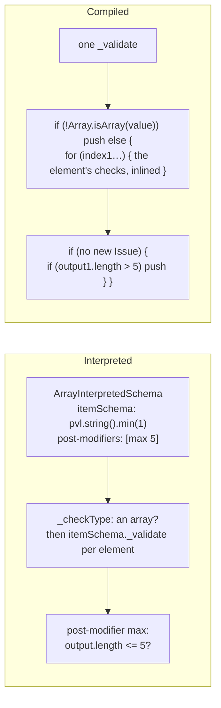
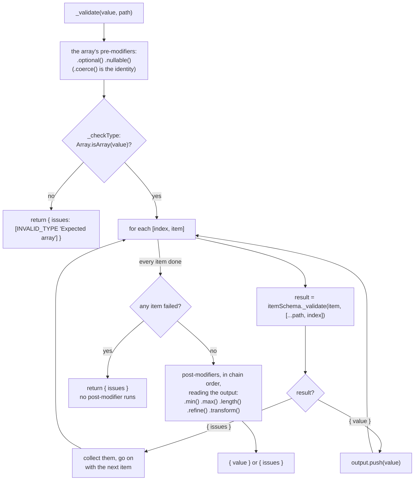
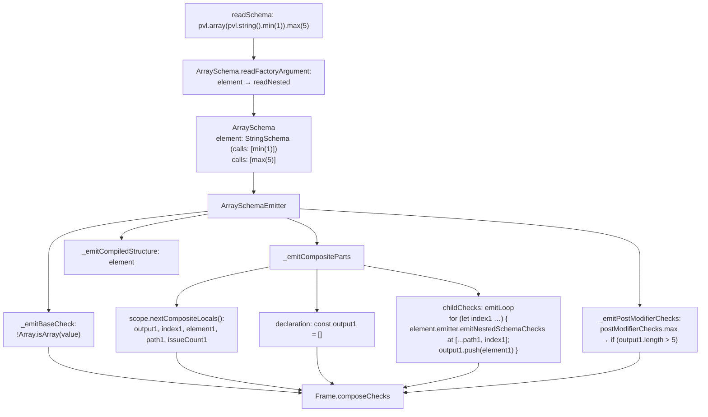
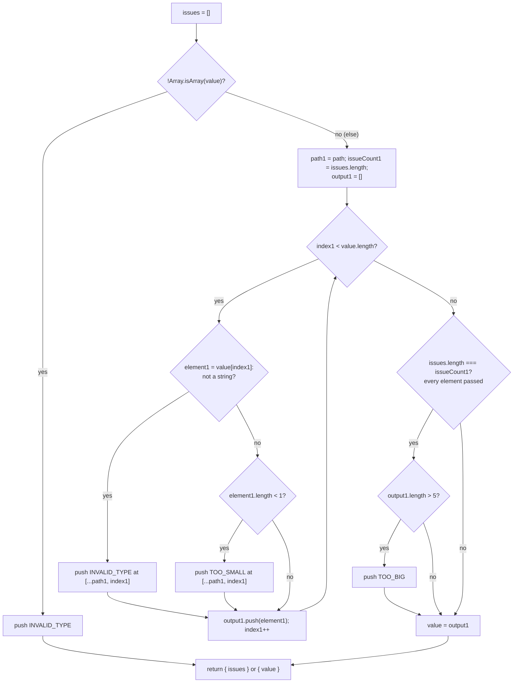
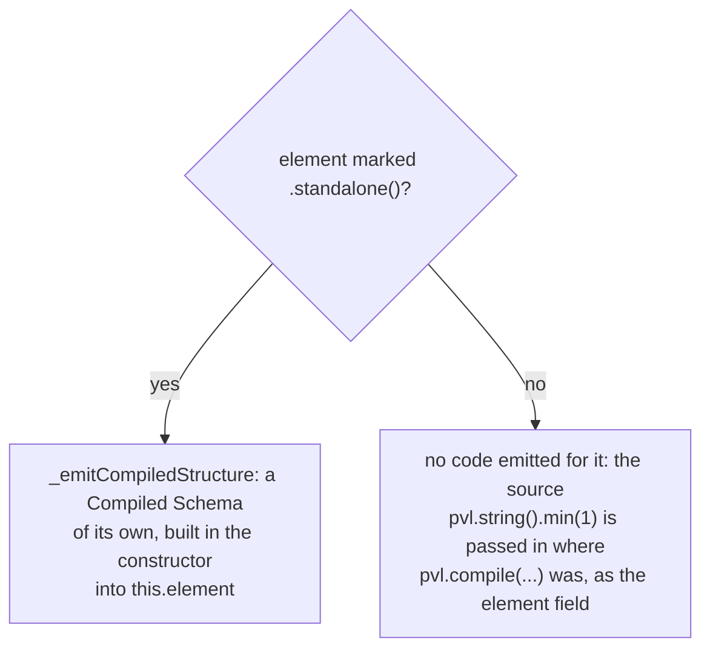

# Array schema

`pvl.array(element)` accepts an array whose every element matches the `element` [Schema](./Concepts.md#schema). It is a composite: the element can itself be an object or an array, at any depth. Its [Constraints](./Concepts.md#constraint) check the array's length.

```ts
const tags = pvl.array(pvl.string().min(1)).max(5);

tags.validate(['a', 'b']); // { value: ['a', 'b'] }
tags.validate(['a', '', 42]); // { issues: [TOO_SMALL at [1], INVALID_TYPE at [2]] }
tags.validate(['a', 'b', 'c', 'd', 'e', 'f']); // { issues: [TOO_BIG 'Array must contain at most 5 element(s)'] }
```

Every element is checked, even after an earlier one failed. The array's own Constraints run only once every element passed.

## At a glance



## Interpreted

`ArrayInterpretedSchema` holds the element Schema and exposes it as `element`. `_checkType` checks that the value is an array, then calls the element Schema's own `_validate` on every item, with the index added to the path. Each item runs the element's whole [pipeline](./Interpreted-Pipeline.md).



## Compiled

### What the compiler does

The element is the factory's argument, read through `readNested` into the Schema of its own factory. `ArraySchemaEmitter` writes one loop, with the element's checks inlined in it.



### What the emitted code does

`pvl.compile(pvl.array(pvl.string().min(1)).max(5))` compiles to this `_validate`:

<!-- prettier-ignore -->
```ts
_validate(value: unknown, path: ReadonlyArray<PropertyKey>): PvlResult<unknown> {
  const issues: PvlIssue[] = [];
  if (!Array.isArray(value)) {
    issues.push({ code: "INVALID_TYPE", message: "Expected array", path: path.length > 0 ? path : undefined });
  } else {
    const path1 = path;
    const issueCount1 = issues.length;
    const output1: unknown[] = [];
    for (let index1 = 0; index1 < value.length; index1++) {
      const element1: unknown = value[index1];
      if (typeof element1 !== "string") {
        issues.push({ code: "INVALID_TYPE", message: "Expected string", path: [...path1, index1] });
      } else {
        if (element1.length < 1) {
          issues.push({ code: "TOO_SMALL", message: "String must contain at least 1 character(s)", path: [...path1, index1] });
        }
      }
      output1.push(element1);
    }
    if (issues.length === issueCount1) {
      if (output1.length > 5) {
        issues.push({ code: "TOO_BIG", message: "Array must contain at most 5 element(s)", path: path.length > 0 ? path : undefined });
      }
    }
    value = output1;
  }
  return issues.length > 0 ? { issues } : { value };
}
```



An element that is itself an object or an array is inlined in the loop the same way, with its own numbered locals, and its value declared with `let`.

## The `element` property

Interpreted and compiled, an array exposes its element Schema as `element`. Unlike an object's `shape`, every array has it, marked or not; marking the element `.standalone()` only decides whether the compiled one is compiled too.



So the unmarked element above is passed to the class as is, which makes the root a generic arrow function, typed by the element it is handed:

<!-- prettier-ignore -->
```ts
export const tags = (<TElement0,>(element: TElement0): PvlSchema<string[], string[]> & { readonly element: TElement0 } => new (class PvlCompiledSchema0 implements PvlSchema<string[], string[]> {
  declare readonly [PVL_SCHEMA_BRAND]: true;
  readonly _standalone: boolean = false;

  constructor(readonly element: TElement0) {}
  …
})(element))(pvl.string().min(1));
```

The array's own `_validate` never calls `element`: its checks are inlined in the loop. A transformed array has no `element`.

## Local Modifiers

| Method                     | Issue code       | Default message                            | Interpreted passes when | Compiled fails when    |
| -------------------------- | ---------------- | ------------------------------------------ | ----------------------- | ---------------------- |
| `.min(n, { message }?)`    | `TOO_SMALL`      | `Array must contain at least n element(s)` | `value.length >= n`     | `output1.length < n`   |
| `.max(n, { message }?)`    | `TOO_BIG`        | `Array must contain at most n element(s)`  | `value.length <= n`     | `output1.length > n`   |
| `.length(n, { message }?)` | `INVALID_LENGTH` | `Array must contain exactly n element(s)`  | `value.length === n`    | `output1.length !== n` |

## Source

- [`arrayInterpretedSchema.ts`](../../packages/schema/src/schemas/arrayInterpretedSchema.ts): `ArrayInterpretedSchema`, `ARRAY_SCHEMA_ISSUE_MESSAGE`
- [`schemas/arraySchema.ts`](../../packages/schema-compiler/src/schemas/arraySchema.ts): `ArraySchema`
- [`emitters/arraySchemaEmitter.ts`](../../packages/schema-compiler/src/emitters/arraySchemaEmitter.ts): `ArraySchemaEmitter`, `emitLoop`

Further reading: [schema-types.md](../specification/schema/schema-types.md), [code-generation.md](../specification/schema-compiler/code-generation.md#a-compiled-schema-exposes-its-standalone-keys), [ADR-0012](../adr/0012-composite-schemas-collect-every-issue.md), [ADR-0036](../adr/0036-standalone-keys-are-reinstated-and-shape-and-element-survive-every-call-but-transform.md).
