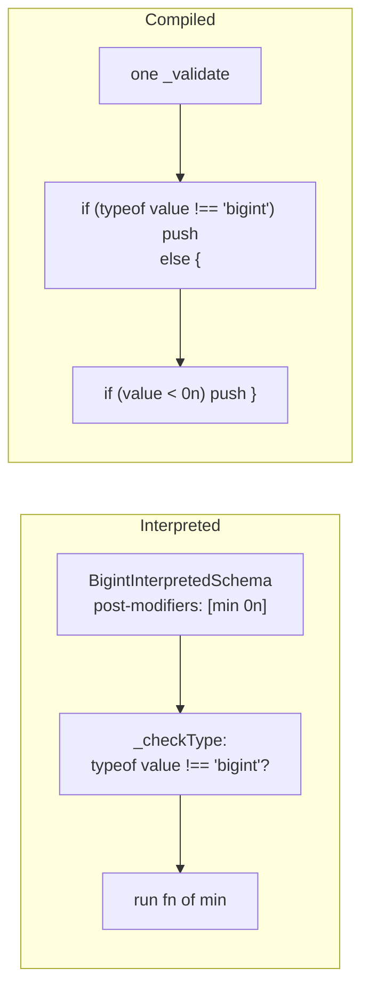
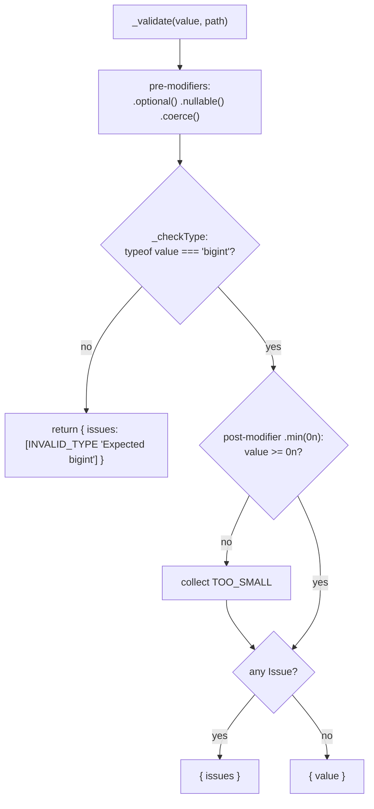
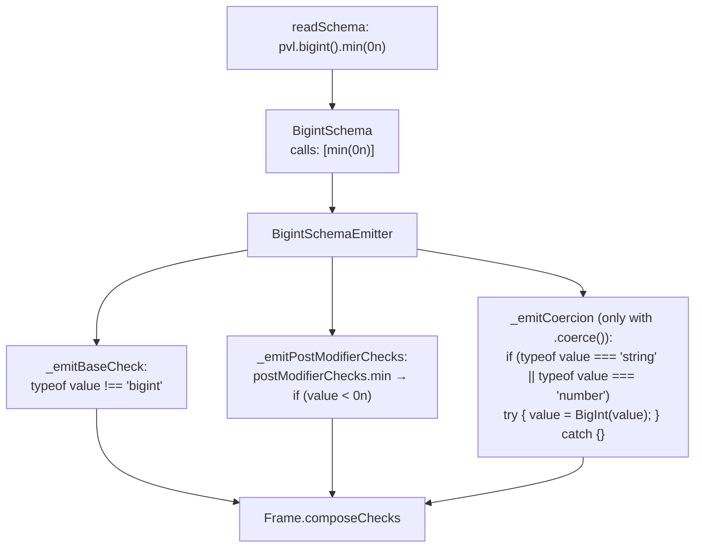
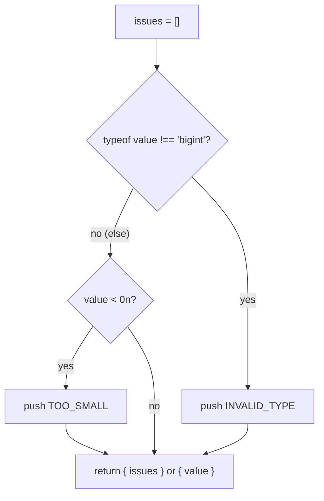

# BigInt schema

`pvl.bigint()` accepts a JavaScript `bigint` only, never a `number`. Its [Constraints](./Concepts.md#constraint) compare it against `bigint` bounds.

```ts
const balance = pvl.bigint().min(0n);

balance.validate(100n); // { value: 100n }
balance.validate(-1n); // { issues: [{ code: 'TOO_SMALL', message: 'Bigint must be greater than or equal to 0' }] }
balance.validate(100); // { issues: [{ code: 'INVALID_TYPE', message: 'Expected bigint' }] }
```

There is no `.int()`: a `bigint` is always whole. The output stays a `bigint`, never converted to a `number`, which would lose the precision `bigint` exists for.

## At a glance



## Interpreted

`BigintInterpretedSchema` runs the [interpreted pipeline](./Interpreted-Pipeline.md). Its own parts:

- **`_checkType`**: `typeof value !== 'bigint'` reports `INVALID_TYPE`, `"Expected bigint"`.
- **`.min()`, `.max()`**: each appends a [post-modifier](./Concepts.md#pre-modifier-and-post-modifier) comparing with `>=` / `<=` against a `bigint` bound.
- **`_coerceInput`**: `coerceToBigint`, for [`.coerce()`](./Coerce.md): a `string` or `number` goes through `BigInt(value)`. When `BigInt()` throws (`'12.5'`, `1.5`), the value is left as it is, and the type check rejects it.



## Compiled

### What the compiler does

`readSchema` reads `pvl.bigint()` into a `BigintSchema` holding its chained calls. A `bigint` literal written in place (`0n`) is read statically, and written back into the code as a `bigint` literal.



### What the emitted code does

`pvl.compile(pvl.bigint().min(0n))` compiles to:

<!-- prettier-ignore -->
```ts
_validate(value: unknown, path: ReadonlyArray<PropertyKey>): PvlResult<unknown> {
  const issues: PvlIssue[] = [];
  if (typeof value !== "bigint") {
    issues.push({ code: "INVALID_TYPE", message: "Expected bigint", path: path.length > 0 ? path : undefined });
  } else {
    if (value < 0n) {
      issues.push({ code: "TOO_SMALL", message: "Bigint must be greater than or equal to 0", path: path.length > 0 ? path : undefined });
    }
  }
  return issues.length > 0 ? { issues } : { value };
}
```



## Local Modifiers

| Method                  | Issue code  | Default message                             | Interpreted passes when | Compiled fails when |
| ----------------------- | ----------- | ------------------------------------------- | ----------------------- | ------------------- |
| `.min(n, { message }?)` | `TOO_SMALL` | `Bigint must be greater than or equal to n` | `value >= n`            | `value < n`         |
| `.max(n, { message }?)` | `TOO_BIG`   | `Bigint must be less than or equal to n`    | `value <= n`            | `value > n`         |

## Source

- [`bigintInterpretedSchema.ts`](../../packages/schema/src/schemas/bigintInterpretedSchema.ts): `BigintInterpretedSchema`, `BIGINT_SCHEMA_ISSUE_MESSAGE`
- [`schemas/bigintSchema.ts`](../../packages/compiler/src/schemas/bigintSchema.ts): `BigintSchema`
- [`emitters/bigintSchemaEmitter.ts`](../../packages/compiler/src/emitters/bigintSchemaEmitter.ts): `BigintSchemaEmitter`

Further reading: [schema-types.md](../specification/schema/schema-types.md).
