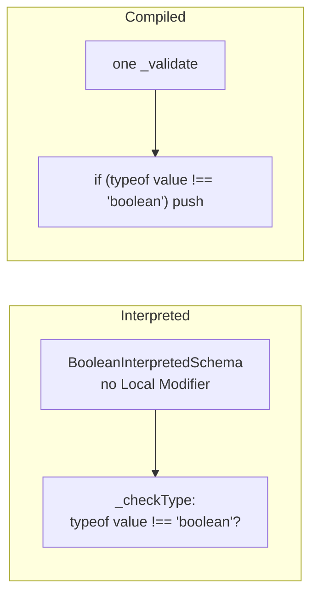
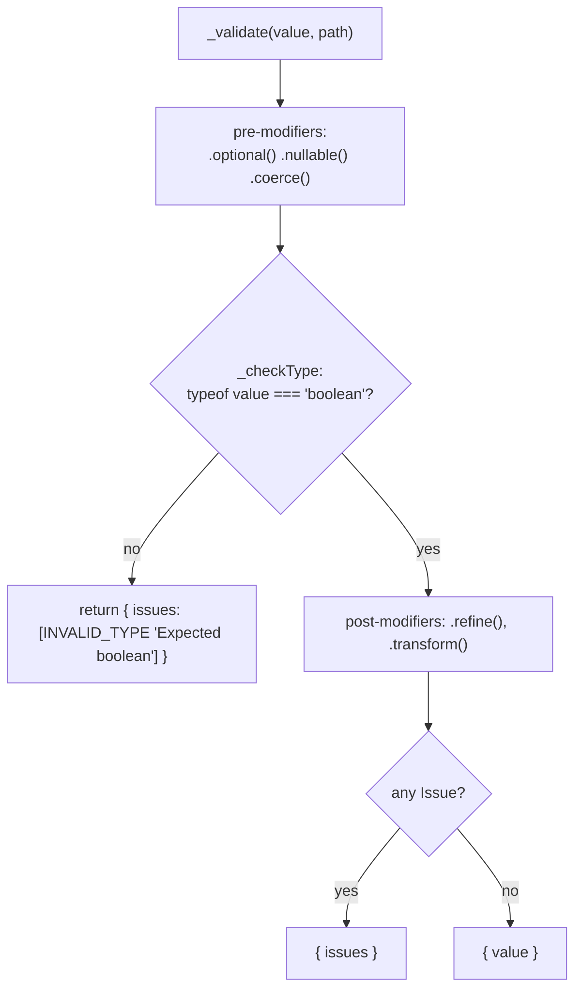
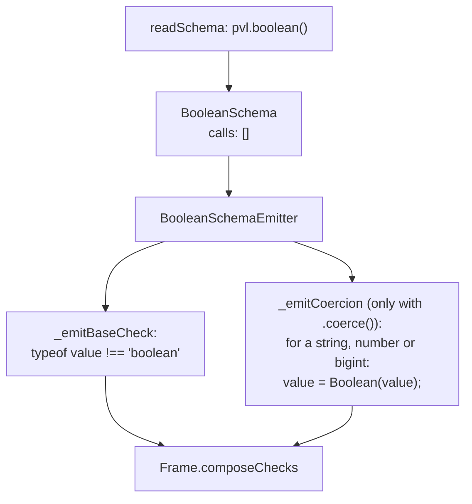
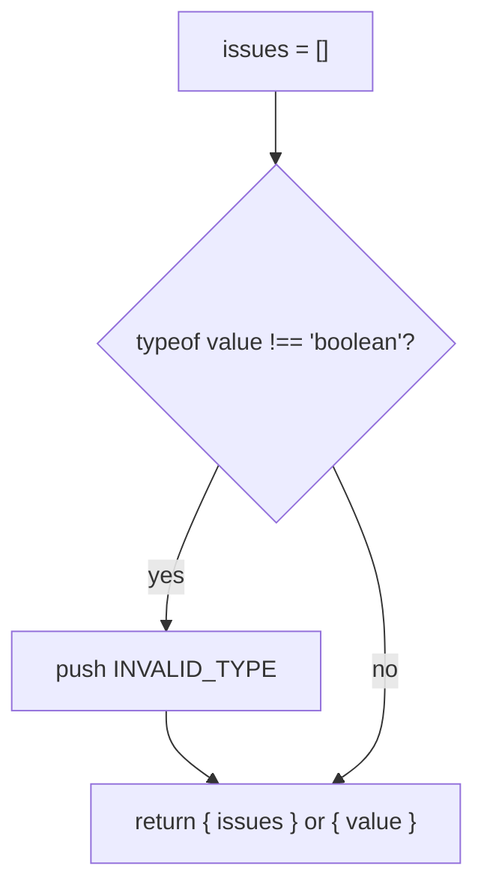

# Boolean schema

`pvl.boolean()` accepts `true` and `false`. It has no [Constraints](./Concepts.md#constraint), only the [Shared Modifiers](./Concepts.md#shared-modifier-and-local-modifier).

```ts
const accepted = pvl.boolean();

accepted.validate(true); // { value: true }
accepted.validate('true'); // { issues: [{ code: 'INVALID_TYPE', message: 'Expected boolean' }] }
```

## At a glance



## Interpreted

`BooleanInterpretedSchema` runs the [interpreted pipeline](./Interpreted-Pipeline.md). Its own parts:

- **`_checkType`**: `typeof value !== 'boolean'` reports `INVALID_TYPE`, `"Expected boolean"`.
- **`_coerceInput`**: `coerceToBoolean`, for [`.coerce()`](./Coerce.md): a `string`, `number` or `bigint` becomes `Boolean(value)`. That is JavaScript truthiness, so every non-empty string, `'false'` included, becomes `true`.



## Compiled

### What the compiler does

`readSchema` reads `pvl.boolean()` into a `BooleanSchema`. `BooleanSchemaEmitter` has no `postModifierChecks` of its own, only the ones it inherits (`.refine()`).



### What the emitted code does

`pvl.compile(pvl.boolean())` compiles to:

<!-- prettier-ignore -->
```ts
_validate(value: unknown, path: ReadonlyArray<PropertyKey>): PvlResult<unknown> {
  const issues: PvlIssue[] = [];
  if (typeof value !== "boolean") {
    issues.push({ code: "INVALID_TYPE", message: "Expected boolean", path: path.length > 0 ? path : undefined });
  }
  return issues.length > 0 ? { issues } : { value };
}
```

With no post-modifier, the base check has no `else`.



## Local Modifiers

None.

## Source

- [`booleanInterpretedSchema.ts`](../../packages/schema/src/schemas/booleanInterpretedSchema.ts): `BooleanInterpretedSchema`, `BOOLEAN_SCHEMA_ISSUE_MESSAGE`
- [`schemas/booleanSchema.ts`](../../packages/schema-compiler/src/schemas/booleanSchema.ts): `BooleanSchema`
- [`emitters/booleanSchemaEmitter.ts`](../../packages/schema-compiler/src/emitters/booleanSchemaEmitter.ts): `BooleanSchemaEmitter`

Further reading: [schema-types.md](../specification/schema/schema-types.md).
