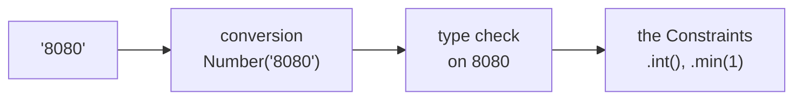
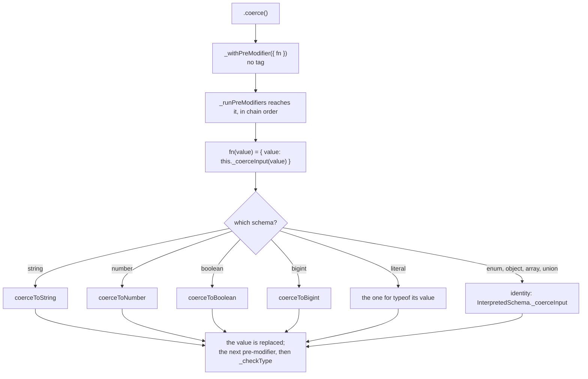
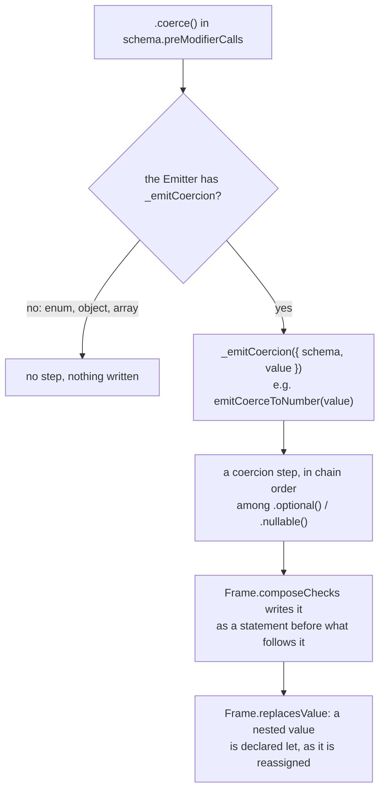

# Coerce

`.coerce()` converts the raw input to the [Schema](./Concepts.md#schema)'s type **before** the [type check](./Concepts.md#type-check), so `'8080'` can pass a number Schema. It is a [Shared Modifier](./Concepts.md#shared-modifier-and-local-modifier), so every Schema has it, but only the primitives and `literal` have a conversion.

```ts
const port = pvl.number().int().min(1).coerce();

port.validate('8080'); // { value: 8080 }
port.validate('nope'); // { issues: [{ code: 'INVALID_TYPE', message: 'Expected number' }] }
```

A coercion never reports an Issue of its own: a value it can't convert is handed on unchanged, and the type check rejects it.

## The short version



## The conversions

| Schema                             | Conversion                                                            | Example                                        |
| ---------------------------------- | --------------------------------------------------------------------- | ---------------------------------------------- |
| `string`                           | `String(value)`, for every input                                      | `42` → `'42'`, `undefined` → `'undefined'`     |
| `number`                           | `Number(value)` for a `string` or `boolean`, else unchanged           | `'42'` → `42`, `'abc'` → `NaN` (rejected)      |
| `boolean`                          | `Boolean(value)` for a `string`, `number` or `bigint`, else unchanged | `1` → `true`, `'false'` → `true`               |
| `bigint`                           | `BigInt(value)` for a `string` or `number`, unchanged if it throws    | `'42'` → `42n`, `'12.5'` → `'12.5'` (rejected) |
| `literal`                          | The conversion of its value's primitive                               | `pvl.literal(42)` converts as `number`         |
| `enum`, `object`, `array`, `union` | None: there's no single target type                                   | the value is checked as it came                |

## Interpreted

`.coerce()` appends an untagged [pre-modifier](./Concepts.md#pre-modifier-and-post-modifier) whose function returns `{ value: this._coerceInput(value) }`. `_coerceInput` is the identity on `InterpretedSchema`, and each primitive and `literal` overrides it with one of the shared functions in `coercions.ts`.



## Compiled

The conversion is written inline as an assignment to the value, before the type check. Its code comes from the Emitter's `_emitCoercion` hook, which each primitive's Emitter and `LiteralSchemaEmitter` define with the functions in the compiler's `emitters/coercions.ts`. An Emitter without the hook (enum, object, array) writes nothing for `.coerce()`.



`pvl.compile(pvl.number().coerce())` compiles to:

<!-- prettier-ignore -->
```ts
_validate(value: unknown, path: ReadonlyArray<PropertyKey>): PvlResult<unknown> {
  const issues: PvlIssue[] = [];
  if (typeof value === "string" || typeof value === "boolean") {
    value = Number(value);
  }
  if (typeof value !== "number" || Number.isNaN(value)) {
    issues.push({ code: "INVALID_TYPE", message: "Expected number", path: path.length > 0 ? path : undefined });
  }
  return issues.length > 0 ? { issues } : { value };
}
```

A coerced Schema's Input type is `unknown`, interpreted and compiled, as it takes any value.

## Order matters against `.optional()` and `.nullable()`

All three are pre-modifiers, so they run in chain order. `pvl.string().optional().coerce()` accepts `undefined` before the conversion, so it compiles to:

<!-- prettier-ignore -->
```ts
if (!((value === undefined))) {
  value = String(value);
  if (typeof value !== "string") {
    issues.push({ code: "INVALID_TYPE", message: "Expected string", path: path.length > 0 ? path : undefined });
  }
}
```

`pvl.string().coerce().optional()` converts first, so `undefined` becomes `'undefined'` and the guard after it never fires. The [Constraints](./Concepts.md#constraint) are post-modifiers, so `.coerce()` always runs before them, wherever it was chained.

## Source

- [`chainableInterpretedSchema.ts`](../../packages/schema/src/schemas/chainableInterpretedSchema.ts): `coerce()`
- [`coercions.ts`](../../packages/schema/src/coercions.ts): `coerceToString`, `coerceToNumber`, `coerceToBoolean`, `coerceToBigint`
- [`emitters/coercions.ts`](../../packages/compiler/src/emitters/coercions.ts): the same conversions, written as code
- [`emitters/emitter.ts`](../../packages/compiler/src/emitters/emitter.ts): `_emitPreModifierSteps`

Further reading: [pipeline.md](../specification/schema/pipeline.md#refinements-transforms-coercion), [schema-types.md](../specification/schema/schema-types.md).
