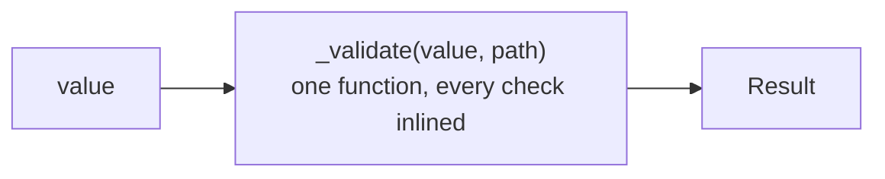
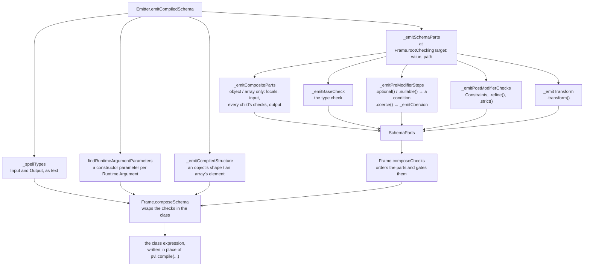
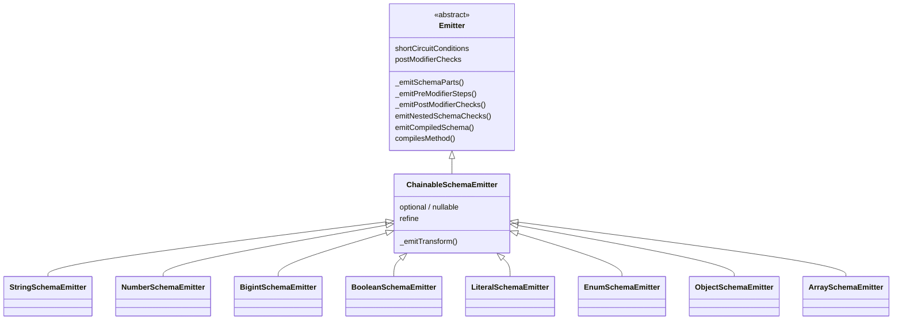
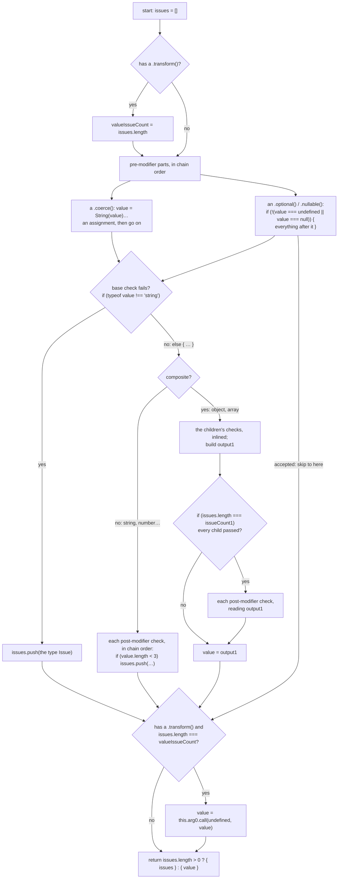
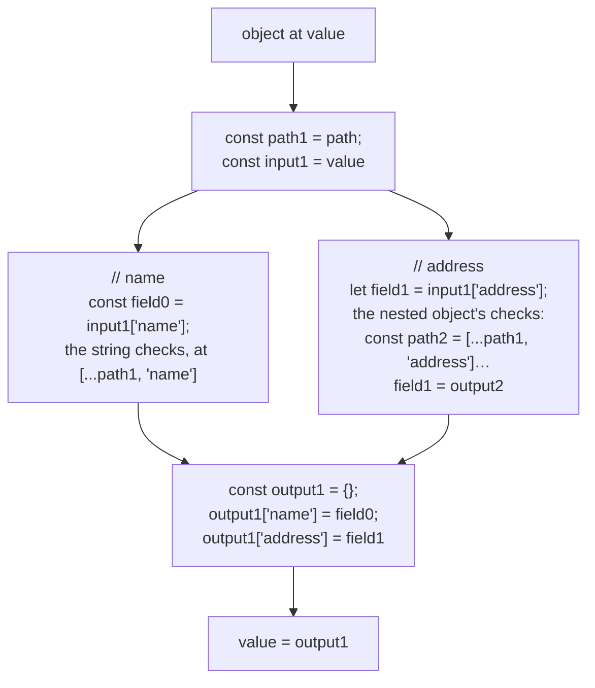

# Compiled schema runtime

What every [Compiled Schema](./Concepts.md#compiled-schema) looks like, and how the [Emitters](./Concepts.md#emitter) and the [Frame](./Concepts.md#frame) write it. [Compiler build pipeline](./Compiler-Build-Pipeline.md) covers how the compiler gets here. Each schema page shows the checks its own Emitter writes.

## The short version

A Compiled Schema is an object of a class the compiler writes in place of the `pvl.compile(...)` call. It has the same methods as an interpreted Schema, but its `_validate` holds every check of the whole Schema as straight-line `if`/`for` code: no list of steps, no nested Schema objects, no function call per check.



Its checks run in exactly the order the [interpreted pipeline](./Interpreted-Pipeline.md) runs them, so both accept the same values and report the same [Issues](./Concepts.md#issue), in the same order. A test runs the same inputs through both and compares the results.

## The class

The whole Compiled Schema of `pvl.compile(pvl.string().min(3).max(20))`, as written into the Destination Directory:

<!-- prettier-ignore -->
```ts
export const username = (new (class PvlCompiledSchema0 implements PvlSchema<string, string> {
  declare readonly [PVL_SCHEMA_BRAND]: true;
  readonly _standalone: boolean = false;

  get "~standard"(): PvlStandardSchemaProps<string, string> {
    return { version: 1, vendor: "@pcvl/schema", types: undefined, validate: (value: unknown) => this.validate(value) };
  }

  validate(value: unknown): PvlResult<string> {
    return this._validate(value, []) as PvlResult<string>;
  }

  _validate(value: unknown, path: ReadonlyArray<PropertyKey>): PvlResult<unknown> {
    const issues: PvlIssue[] = [];
    if (typeof value !== "string") {
      issues.push({ code: "INVALID_TYPE", message: "Expected string", path: path.length > 0 ? path : undefined });
    } else {
      if (value.length < 3) {
        issues.push({ code: "TOO_SMALL", message: "String must contain at least 3 character(s)", path: path.length > 0 ? path : undefined });
      }
      if (value.length > 20) {
        issues.push({ code: "TOO_BIG", message: "String must contain at most 20 character(s)", path: path.length > 0 ? path : undefined });
      }
    }
    return issues.length > 0 ? { issues } : { value };
  }

  standalone(): this & PvlStandaloneMarker {
    return Object.assign(Object.create(Object.getPrototypeOf(this) as object) as this, this, { _standalone: true }) as unknown as this & PvlStandaloneMarker;
  }
})() as PvlSchema<string, string>);
```

| Member                   | What it does                                                                                                  |
| ------------------------ | ------------------------------------------------------------------------------------------------------------- |
| `[PVL_SCHEMA_BRAND]`     | A type-only brand: TypeScript accepts the class wherever a `@pcvl/schema` Schema is expected                  |
| `_standalone`            | Whether it is marked `.standalone()`, which an interpreted object reads when this Schema is one of its fields |
| `"~standard"`            | The [Standard Schema](https://standardschema.dev) interface, so other libraries can use it                    |
| `validate(value)`        | Calls `_validate` at the root path, as the interpreted `validate` does                                        |
| `_validate(value, path)` | The emitted checks                                                                                            |
| `standalone()`           | Returns a marked copy, as the interpreted `standalone()` does                                                 |

The class implements the `Schema` type and extends nothing, so the code imports only types from `@pcvl/schema`: nothing of the library runs during validation. Every message is written in as text, computed by `@pcvl/schema`'s own message functions while compiling, so the two can't drift apart. The final `as PvlSchema<…>` types the result exactly as `pvl.compile()` typed it before compiling, so swapping the source for the Destination Directory changes no type.

## How the checks are written

The same Emitter code writes the root Schema and every nested one. Each Emitter only writes **parts**, as text, and the Frame puts the parts in order.



A chained method is found by name in a table on its Emitter: `.min` in `StringSchemaEmitter.postModifierChecks`, `.optional` in `ChainableSchemaEmitter.shortCircuitConditions`. Having a method in a table is what makes it compile. A method no table holds is `UNSUPPORTED_SCHEMA`.

The Emitters extend each other as the interpreted Schemas do:



## How the emitted checks run

`Frame.composeChecks` places the parts the same way at the root and nested. Read top to bottom, the code it writes does this:



What maps to what:

| Interpreted                                                         | Compiled                                                                           |
| ------------------------------------------------------------------- | ---------------------------------------------------------------------------------- |
| A `SHORT_CIRCUIT` pre-modifier returns `{ value }`                  | An `if (!(…))` around everything after it                                          |
| `.coerce()` returns `{ value: converted }`                          | An assignment to `value`, so `value` is declared `let` when nested                 |
| A failed `_checkType` returns at once                               | Its Issue is pushed and every later check sits in its `else`                       |
| A composite calls each child's `_validate`                          | Each child's checks are inlined where the parent reads the field or element        |
| Post-modifiers run once `_checkType`, every child included, passed  | `if (issues.length === issueCount1)`, as every check pushes onto the same `issues` |
| `REQUIRES_ALL_PASSED`, `RUNS_AFTER_SHORT_CIRCUIT` on `.transform()` | Counted before the short-circuit guard, run after it, only if no Issue was added   |
| A step returns `{ issues }`                                         | `issues.push(…)`: the code never returns early                                     |

The emitted code never returns until the very end: a `return` inside a nested Schema's checks would skip the parent's other fields.

## Nested Schemas

A nested Schema is inlined where its parent reads it. Its value gets a local of its own (`field0`, `element1`), and a composite's locals are numbered across the whole class (`input1`, `path2`, `output2`), so nothing clashes at any depth.



## Runtime Arguments

A method argument that isn't a literal written in place is a [Runtime Argument](./Concepts.md#runtime-argument). The class takes it through its constructor, so it is evaluated once, where the `pvl.compile(...)` call was, and the checks read the stored field. A default message naming it is built once, in the constructor, rather than on every failure.

<!-- prettier-ignore -->
```ts
// source
export const getName = (maxLength: number) => pvl.compile(pvl.string().max(maxLength));

// compiled (shortened)
export const getName = (maxLength: number) => (new (class PvlCompiledSchema0 implements PvlSchema<string, string> {
  …
  readonly arg0Message: string;

  constructor(readonly arg0: number) {
    this.arg0Message = `String must contain at most ${arg0} character(s)`;
  }
  …
      if (value.length > this.arg0) {
        issues.push({ code: "TOO_BIG", message: this.arg0Message, path: path.length > 0 ? path : undefined });
      }
  …
})(maxLength) as PvlSchema<string, string>);
```

A function passed to `.refine()` or `.transform()` is always a Runtime Argument: the compiler calls your function, it never copies its body. See [Refine](./Refine.md) and [Transform](./Transform.md).

## Source

- [`emitters/emitter.ts`](../../packages/compiler/src/emitters/emitter.ts): `Emitter`, `_emitSchemaParts`, `emitNestedSchemaChecks`, `emitCompiledSchema`
- [`emitters/frame.ts`](../../packages/compiler/src/emitters/frame.ts): `Frame.composeChecks`, `Frame.composeSchema`
- [`emitters/chainableSchemaEmitter.ts`](../../packages/compiler/src/emitters/chainableSchemaEmitter.ts): the Shared Modifiers
- [`emitters/scope.ts`](../../packages/compiler/src/emitters/scope.ts): the numbered locals
- [`emitters/emittersTypes.ts`](../../packages/compiler/src/emitters/emittersTypes.ts): `SchemaParts` and the method tables
- [`issue.ts`](../../packages/compiler/src/issue.ts): the emitted Issue literals

Further reading: [code-generation.md](../specification/compiler/code-generation.md), [compile.md](../specification/schema/compile.md), [ADR-0023](../adr/0023-compiled-schemas-inline-nested-schemas-and-mirror-schema-methods.md), [ADR-0029](../adr/0029-a-compiled-schema-is-a-class-expression-implementing-the-schema-type.md), [ADR-0032](../adr/0032-an-emitter-returns-a-schemas-parts-and-the-frame-composes-them-as-a-pure-function.md).
