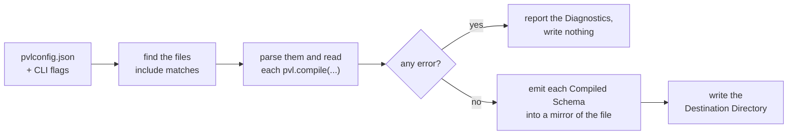
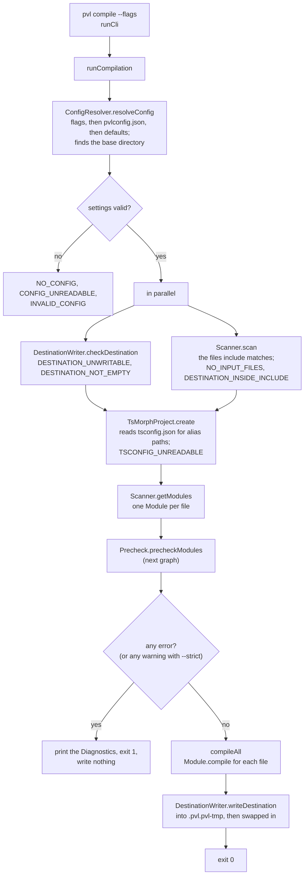
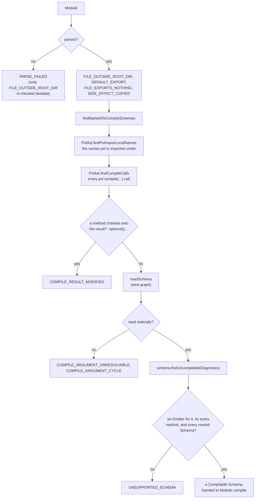
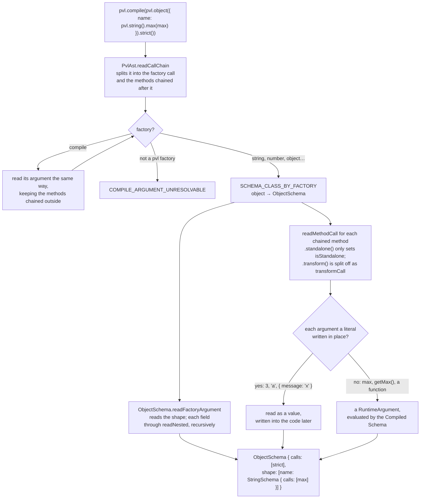
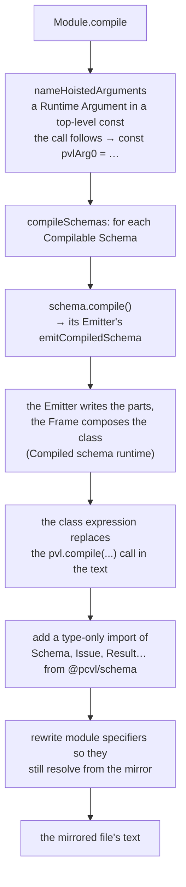

# Compiler build pipeline

What `pvl compile` does, from reading `pvlconfig.json` to writing the [Destination Directory](./Concepts.md#destination-directory). This part is the same for every [Schema](./Concepts.md#schema). Each schema page shows only what its own [Emitter](./Concepts.md#emitter) adds, and [Compiled schema runtime](./Compiled-Schema-Runtime.md) shows how the written code runs.

## The short version

The compiler never runs or imports your code. It parses your files as text (with [ts-morph](https://ts-morph.com)), finds every `pvl.compile(...)` call, reads the Schema inside it, and writes a copy of your source folder with each call replaced by plain validation code.



## The whole run

`pvl compile` (`bin.ts` → `runCli`) parses the flags and calls `runCompilation`, the programmatic entry point. Every step that can fail adds a [Diagnostic](./Concepts.md#diagnostic) and keeps going, so one run lists every problem at once. Only when there are none is anything written.



## Reading the Schemas: `Precheck`

`Precheck` checks each [Module](./Concepts.md#module) and reads its [Marked-to-Compile Schemas](./Concepts.md#marked-to-compile-schema). Reading is purely static: a Schema must be a `pvl.*` call chain written in place, or a top-level `const` of the same file holding one.



`readSchema` turns one call chain into a tree of compiler `Schema` objects, one subclass per factory, each naming its Emitter:



A literal argument is baked into the code. Anything else is a [Runtime Argument](./Concepts.md#runtime-argument), passed to the Compiled Schema's constructor and evaluated once, where it is written.

## Writing a file: `Module.compile`

Each scanned file becomes one mirrored file at the same path under the Destination Directory, whether or not it marks a Schema.



Only the outermost `pvl.compile(...)` is replaced: one nested inside another's argument is compiled into it. A file with no `pvl.compile(...)` is copied with only its module specifiers rewritten.

## Example

The source file `src/schemas/string.ts`:

```ts
import { pvl } from '@pcvl/schema';

export const username = pvl.compile(pvl.string().min(3).max(20));
```

becomes `.pvl/schemas/string.ts` (the class body is shortened here; [String schema](./String-Schema.md#compiled) shows it whole):

<!-- prettier-ignore -->
```ts
// @generated by @pcvl/compiler. Do not edit: run `pvl compile` to regenerate.
import { pvl } from '@pcvl/schema';
import type { Issue as PvlIssue, Result as PvlResult, SCHEMA_BRAND as PVL_SCHEMA_BRAND, Schema as PvlSchema, StandaloneMarker as PvlStandaloneMarker, StandardSchemaProps as PvlStandardSchemaProps } from '@pcvl/schema';

export const username = (new (class PvlCompiledSchema0 implements PvlSchema<string, string> {
  …
  _validate(value: unknown, path: ReadonlyArray<PropertyKey>): PvlResult<unknown> {
    const issues: PvlIssue[] = [];
    if (typeof value !== "string") {
      issues.push({ code: "INVALID_TYPE", message: "Expected string", path: path.length > 0 ? path : undefined });
    } else {
      if (value.length < 3) { … }
      if (value.length > 20) { … }
    }
    return issues.length > 0 ? { issues } : { value };
  }
  …
})() as PvlSchema<string, string>);
```

plus a `.pvl-generated` marker so a later run knows it may replace the folder.

## Source

- [`cli/runCli.ts`](../../packages/compiler/src/cli/runCli.ts), [`compilation/runCompilation.ts`](../../packages/compiler/src/compilation/runCompilation.ts), [`compilation/compileAll.ts`](../../packages/compiler/src/compilation/compileAll.ts)
- [`config/configResolver.ts`](../../packages/compiler/src/config/configResolver.ts), [`scanner/scanner.ts`](../../packages/compiler/src/scanner/scanner.ts), [`tsMorphProject/tsMorphProject.ts`](../../packages/compiler/src/tsMorphProject/tsMorphProject.ts)
- [`precheck/precheck.ts`](../../packages/compiler/src/precheck/precheck.ts), [`schemas/readSchema.ts`](../../packages/compiler/src/schemas/readSchema.ts), [`schemas/schema.ts`](../../packages/compiler/src/schemas/schema.ts), [`runtimeArgument/runtimeArgument.ts`](../../packages/compiler/src/runtimeArgument/runtimeArgument.ts)
- [`ast/pvlAst.ts`](../../packages/compiler/src/ast/pvlAst.ts), [`ast/genericAst.ts`](../../packages/compiler/src/ast/genericAst.ts)
- [`module/module.ts`](../../packages/compiler/src/module/module.ts), [`destination/destinationWriter.ts`](../../packages/compiler/src/destination/destinationWriter.ts)

Further reading: [compilation.md](../specification/compiler/compilation.md), [configuration-and-cli.md](../specification/compiler/configuration-and-cli.md), [destination-directory.md](../specification/compiler/destination-directory.md), [ADR-0002](../adr/0002-static-ast-compilation-via-ts-morph.md), [ADR-0005](../adr/0005-compiler-emits-a-destination-directory-and-rewrites-nothing.md).
