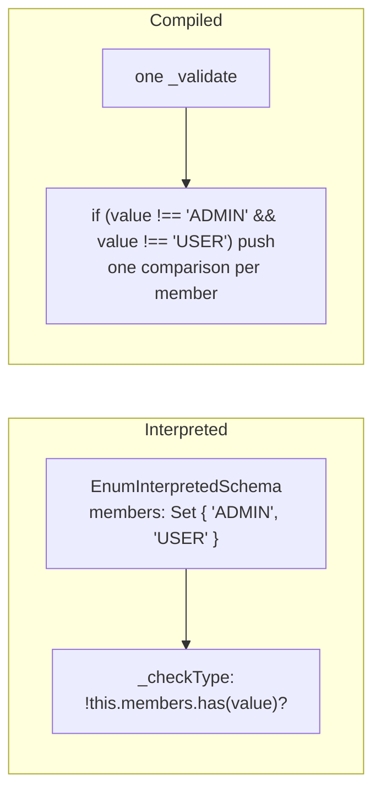
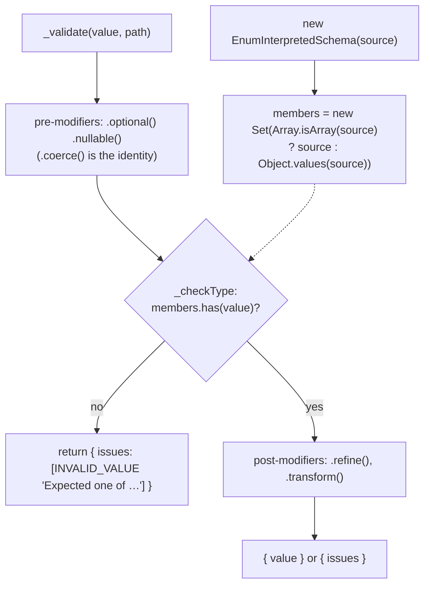
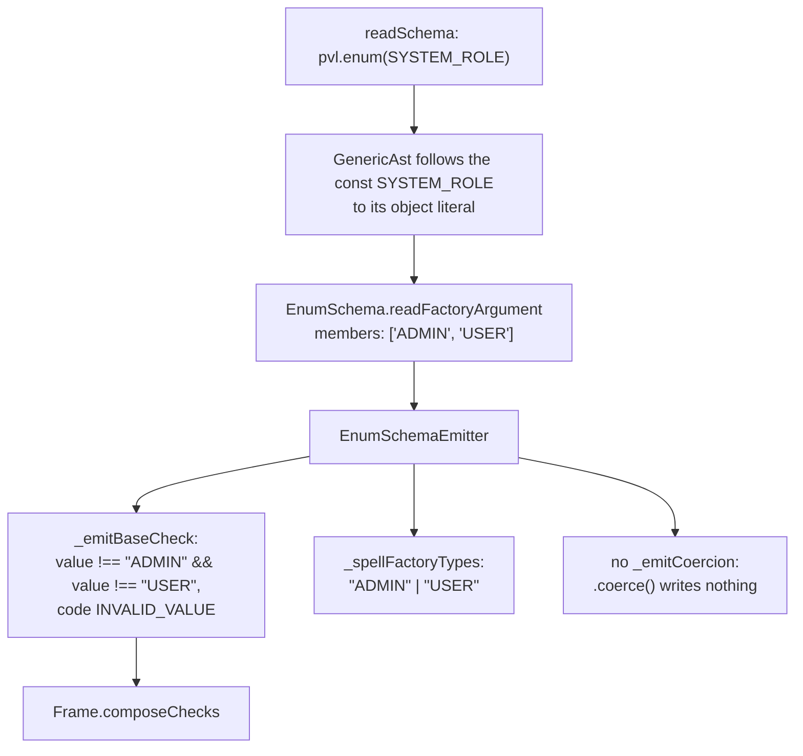
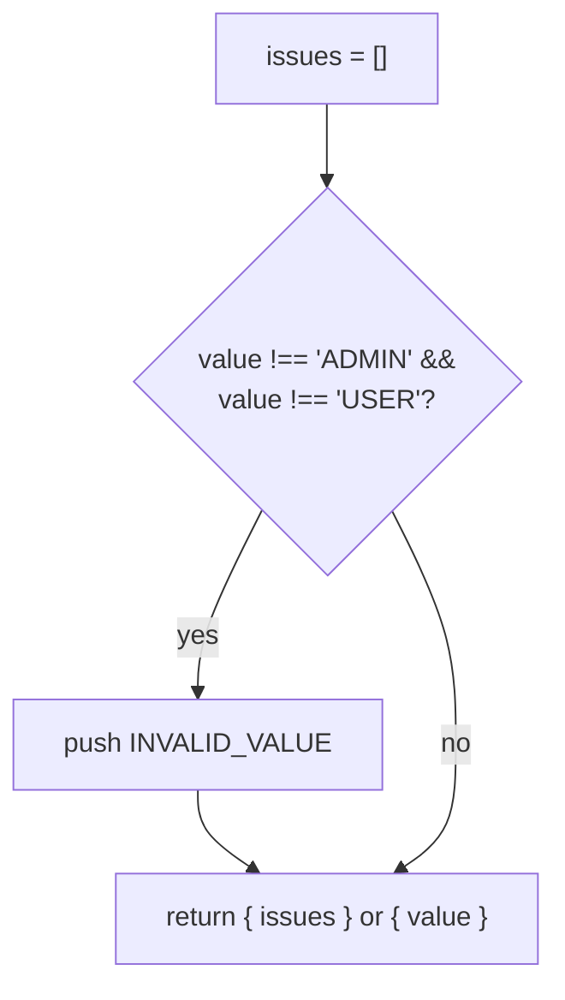

# Enum schema

`pvl.enum(source)` accepts one of a set of strings and numbers. The source is either an `as const` object, whose values are the members, or an array of strings.

```ts
const SYSTEM_ROLE = { ADMIN: 'ADMIN', USER: 'USER' } as const;

const role = pvl.enum(SYSTEM_ROLE); // the same as pvl.enum(['ADMIN', 'USER'])

role.validate('ADMIN'); // { value: 'ADMIN' }
role.validate('GUEST'); // { issues: [{ code: 'INVALID_VALUE', message: 'Expected one of "ADMIN", "USER"' }] }
```

[`.coerce()`](./Coerce.md) does nothing on an enum: its members can mix strings and numbers, so there is no single type to convert to.

## At a glance



## Interpreted

`EnumInterpretedSchema`'s constructor turns the source into a `Set` of members once (`Object.values` of an object, or the array itself). Its own part of the [interpreted pipeline](./Interpreted-Pipeline.md):

- **`_checkType`**: `!this.members.has(value)` reports `INVALID_VALUE`, `Expected one of <every member>`.



## Compiled

### What the compiler does

The source is the factory's argument, so it must be read statically: an array or object literal written in place, or a top-level `const` of the same file holding one (`as const` included). `EnumSchema.readFactoryArgument` reads the members, and `EnumSchemaEmitter` writes one `!==` per member.



### What the emitted code does

`pvl.compile(pvl.enum(['ADMIN', 'USER']))` compiles to:

<!-- prettier-ignore -->
```ts
_validate(value: unknown, path: ReadonlyArray<PropertyKey>): PvlResult<unknown> {
  const issues: PvlIssue[] = [];
  if (value !== "ADMIN" && value !== "USER") {
    issues.push({ code: "INVALID_VALUE", message: "Expected one of \"ADMIN\", \"USER\"", path: path.length > 0 ? path : undefined });
  }
  return issues.length > 0 ? { issues } : { value };
}
```



The interpreted Schema looks the value up in a `Set`; the compiled one compares it with each member, written into the code.

## Local Modifiers

None.

## Source

- [`enumInterpretedSchema.ts`](../../packages/schema/src/schemas/enumInterpretedSchema.ts): `EnumInterpretedSchema`, `ENUM_SCHEMA_ISSUE_MESSAGE`
- [`schemas/enumSchema.ts`](../../packages/compiler/src/schemas/enumSchema.ts): `EnumSchema`
- [`emitters/enumSchemaEmitter.ts`](../../packages/compiler/src/emitters/enumSchemaEmitter.ts): `EnumSchemaEmitter`

Further reading: [schema-types.md](../specification/schema/schema-types.md), [ADR-0009](../adr/0009-enum-accepts-const-object-or-string-literal-array.md).
