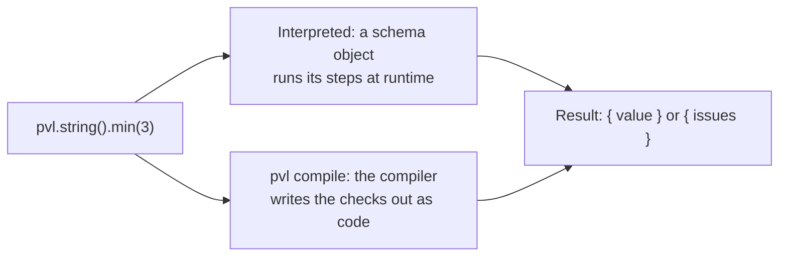

<!-- The source of the GitHub wiki: .github/workflows/wiki.yml publishes this folder on every push to main, replacing the wiki with it. Edit a page here, through a PR, never in the wiki itself (docs/agents/wiki.md). -->

# PVL wiki

**PVL** (Precompiled Validation Library) validates values against schemas you describe in TypeScript. A schema works in two ways:

- **Interpreted**: `@pvl/schema` walks the schema at runtime. Each schema object runs its own steps in order and calls the schemas nested in it.
- **Compiled**: `@pvl/schema-compiler` reads the schema from your source ahead of time and writes plain `if`/`for` code that does the same checks, with nothing left to walk at runtime.

Both ways accept and reject the same values, report the same Issues, and type the same. These pages show, with a graph for each, how every schema works in both.

Start with [Concepts](./Concepts.md) if a term is new to you.

## How validation works

| Page                                                    | What it shows                                                                      |
| ------------------------------------------------------- | ---------------------------------------------------------------------------------- |
| [Interpreted pipeline](./Interpreted-Pipeline.md)       | How every interpreted schema runs its Modifiers around its type check              |
| [Compiler build pipeline](./Compiler-Build-Pipeline.md) | What `pvl compile` does, from the config file to the written Destination Directory |
| [Compiled schema runtime](./Compiled-Schema-Runtime.md) | The shape every Compiled Schema shares, and how its emitted `_validate` runs       |

## Shared Modifiers

Every schema has these five. Each page shows the Modifier interpreted and compiled.

- [Optional](./Optional.md): `.optional()` accepts `undefined`
- [Nullable](./Nullable.md): `.nullable()` accepts `null`
- [Coerce](./Coerce.md): `.coerce()` converts the input before the type check
- [Refine](./Refine.md): `.refine()` adds your own check
- [Transform](./Transform.md): `.transform()` turns the accepted value into another one

## Schemas

| Schema                         | Accepts                                    | Compiles? |
| ------------------------------ | ------------------------------------------ | --------- |
| [String](./String-Schema.md)   | a `string`                                 | yes       |
| [Number](./Number-Schema.md)   | a `number` that isn't `NaN`                | yes       |
| [BigInt](./BigInt-Schema.md)   | a `bigint`                                 | yes       |
| [Boolean](./Boolean-Schema.md) | `true` or `false`                          | yes       |
| [Literal](./Literal-Schema.md) | exactly one value                          | yes       |
| [Enum](./Enum-Schema.md)       | one of a set of strings and numbers        | yes       |
| [Object](./Object-Schema.md)   | an object whose fields match their schemas | yes       |
| [Array](./Array-Schema.md)     | an array whose elements match one schema   | yes       |
| [Union](./Union-Schema.md)     | a value one of several schemas accepts     | not yet   |
