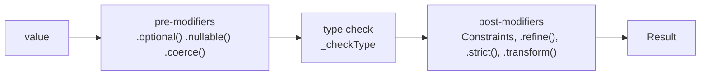
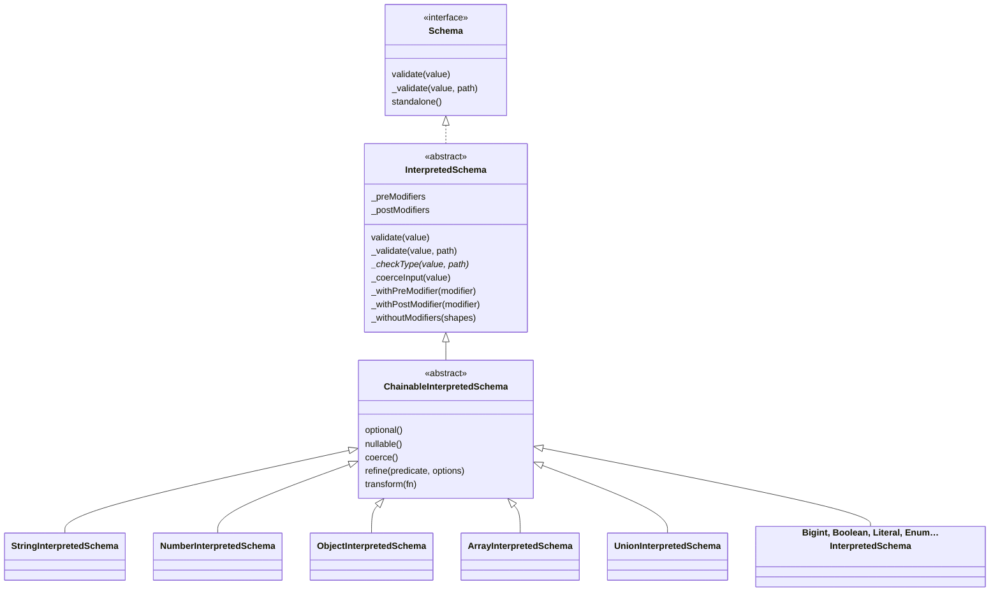
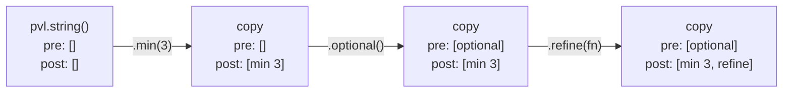
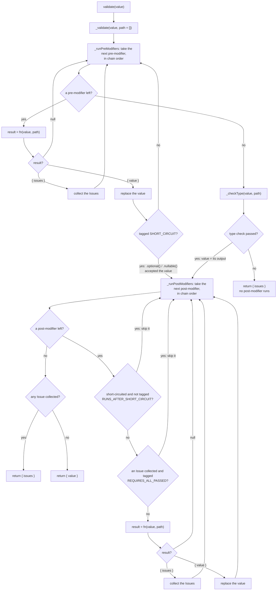
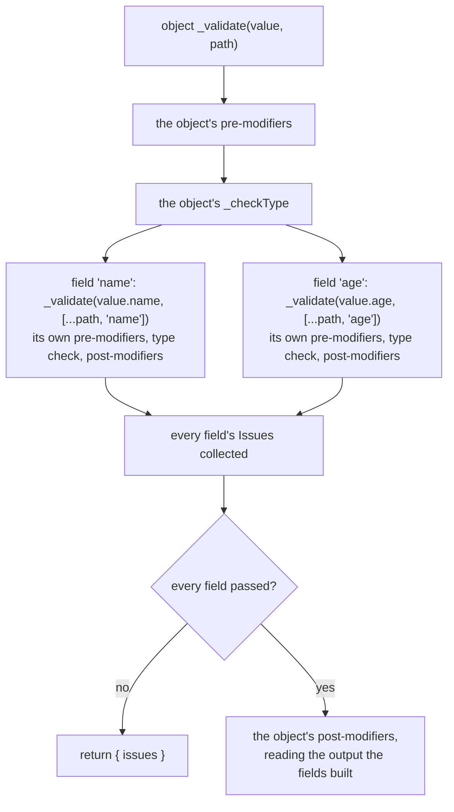

# Interpreted pipeline

How every interpreted [Schema](./Concepts.md#schema) validates. Every schema page links here for the shared part and only adds what its own schema does.

## The short version

An interpreted Schema holds two lists of steps: the [pre-modifiers](./Concepts.md#pre-modifier-and-post-modifier) and the post-modifiers. Validating runs the pre-modifiers, then the [type check](./Concepts.md#type-check), then the post-modifiers, each list in the order the [Modifiers](./Concepts.md#modifier) were chained, and collects every [Issue](./Concepts.md#issue) on the way.

## Building a Schema

Every factory (`pvl.string()`) builds an object of its schema's class (`StringInterpretedSchema`). Every class extends `ChainableInterpretedSchema`, which adds the five [Shared Modifiers](./Concepts.md#shared-modifier-and-local-modifier), and that extends `InterpretedSchema`, which owns the pipeline.

Each Modifier method builds one step, a `Modifier` value holding a function `fn(value, path)`, and returns a **copy** of the Schema with that step appended to one of the two lists (`_withPreModifier` or `_withPostModifier`). The Schema it was called on is never changed, so one Schema can be reused as the start of many chains.

The order of the two lists is the chain order, and the two lists are separate, so a pre-modifier always runs before a post-modifier, wherever it was chained: `pvl.string().min(3).optional()` and `pvl.string().optional().min(3)` validate alike.

## Running a Schema

`validate(value)` calls `_validate(value, [])`, the empty array being the path of the top-level value. A Schema nested in another one is called through `_validate` too, with the parent's path extended by the field's key or the element's index.

The rules the graph follows:

- **A step's result** reads the same everywhere: `null` means "fine, go on", `{ issues }` means "collect these and go on", `{ value }` means "go on with this value instead".
- **A failed type check returns at once.** No post-modifier ever sees a value of the wrong type, so a `.min(3)` never has to ask whether its value is a string.
- **Every other failure is collected, not returned.** A failing `.min(3)` doesn't stop a `.refine()` after it, so one run reports every problem.
- **Tags** are the only exceptions to those rules:

| Tag                        | Carried by                   | Effect                                                                                          |
| -------------------------- | ---------------------------- | ----------------------------------------------------------------------------------------------- |
| `SHORT_CIRCUIT`            | `.optional()`, `.nullable()` | Its `{ value }` accepts the value: the rest of the pre-modifiers and the type check are skipped |
| `RUNS_AFTER_SHORT_CIRCUIT` | `.transform()`               | Still runs after a short-circuit, while every other post-modifier is skipped                    |
| `REQUIRES_ALL_PASSED`      | `.transform()`               | Skipped once any Issue has been collected                                                       |

## A Schema that holds others

An object, an array or a union validates the Schemas it holds inside its own type check, by calling each one's `_validate` with an extended path. Each child runs its own full pipeline there.

That is the cost the compiler removes: every nested Schema is a separate object with its own lists and function calls, walked on every validation.

## Source

- [`interpretedSchema.ts`](../../packages/schema/src/schemas/interpretedSchema.ts): `validate`, `_validate`, `_runPreModifiers`, `_runPostModifiers`, `_withPreModifier`, `_withPostModifier`, `_withoutModifiers`
- [`chainableInterpretedSchema.ts`](../../packages/schema/src/schemas/chainableInterpretedSchema.ts): the five Shared Modifiers
- [`modifiers/modifiers.ts`](../../packages/schema/src/modifiers/modifiers.ts): the `Modifier` type
- [`modifiers/enums.ts`](../../packages/schema/src/modifiers/enums.ts): `MODIFIER_TAG`
- [`pvl.ts`](../../packages/schema/src/pvl.ts): the factories

Further reading: [pipeline.md](../specification/schema/pipeline.md), [ADR-0010](../adr/0010-modifiers-run-in-chain-order-around-the-type-check.md).
