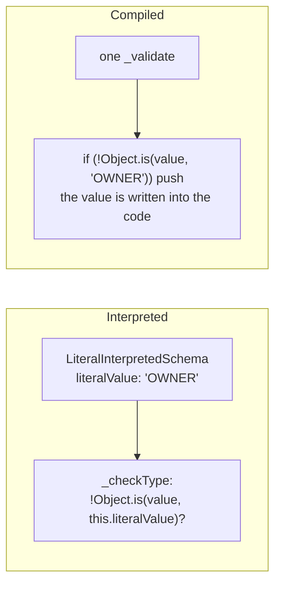
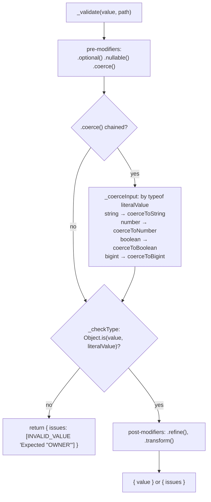
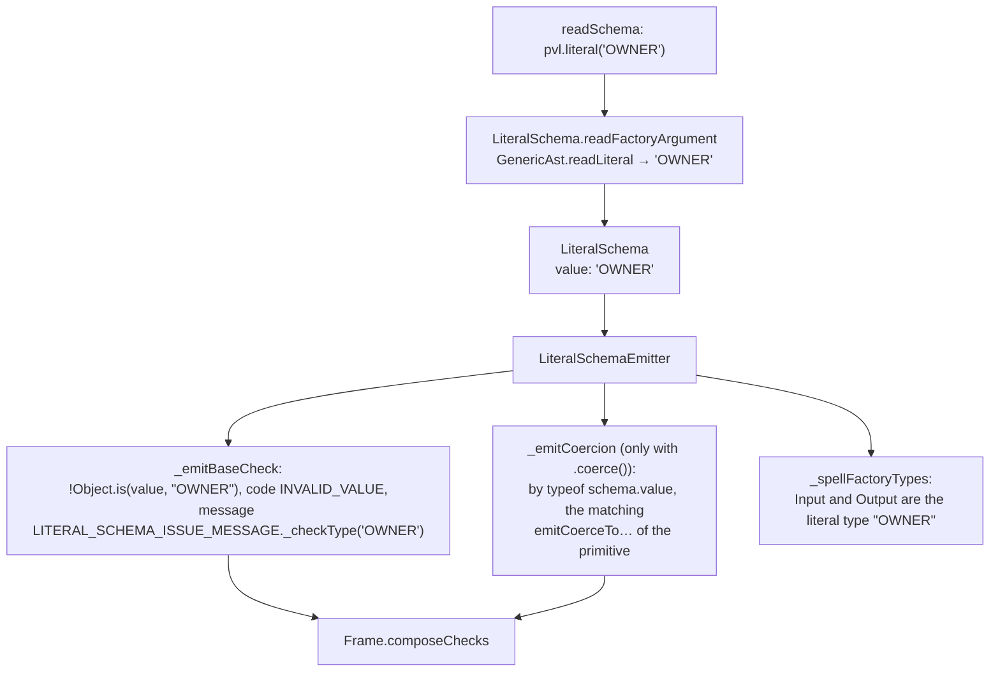
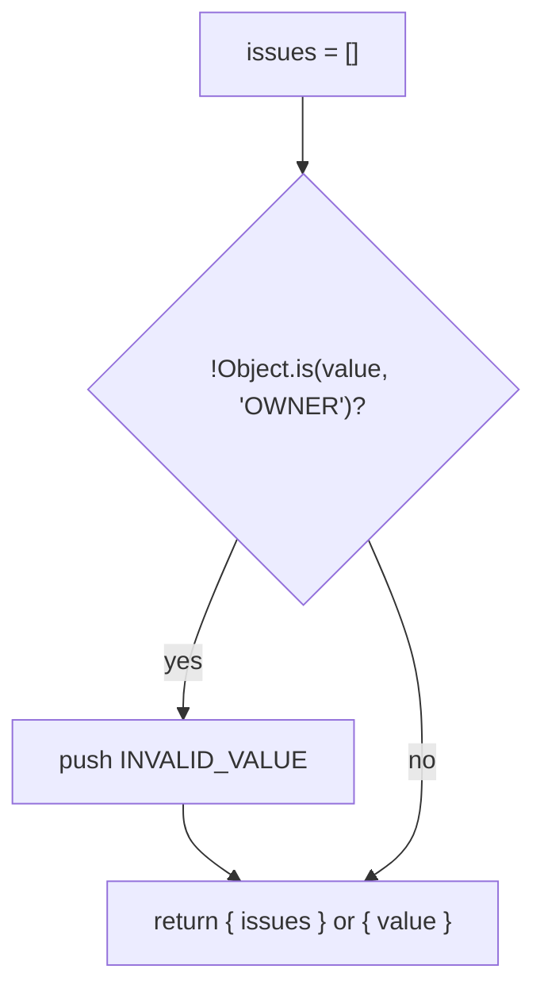

# Literal schema

`pvl.literal(value)` accepts exactly one value: a `string`, `number`, `boolean` or `bigint`.

```ts
const owner = pvl.literal('OWNER');

owner.validate('OWNER'); // { value: 'OWNER' }
owner.validate('ADMIN'); // { issues: [{ code: 'INVALID_VALUE', message: 'Expected "OWNER"' }] }
```

The comparison is `Object.is`, not `===`. They differ on two values only: `pvl.literal(0)` rejects `-0`, and `pvl.literal(NaN)` accepts `NaN`. A right-looking value of the wrong type (`'42'` for `pvl.literal(42)`) is rejected like any wrong value, unless [`.coerce()`](./Coerce.md) converts it first.

## At a glance



## Interpreted

`LiteralInterpretedSchema` keeps the value it was built with and runs the [interpreted pipeline](./Interpreted-Pipeline.md). Its own parts:

- **`_checkType`**: `!Object.is(value, this.literalValue)` reports `INVALID_VALUE`, with the message `Expected <the value>` (`Expected "OWNER"`, `Expected 42`).
- **`_coerceInput`**: picks the conversion of its value's primitive, by `typeof this.literalValue`: `pvl.literal(42).coerce()` converts as `pvl.number().coerce()` does, then compares.



## Compiled

### What the compiler does

The literal is the factory's argument, so it must be read statically: a literal written in place, or a top-level `const` of the same file holding one. `LiteralSchema.readFactoryArgument` reads it into `LiteralSchema.value`, and `LiteralSchemaEmitter` writes it back into the code as a literal. Anything else (an import, a parameter, a call) is `COMPILE_ARGUMENT_UNRESOLVABLE`.



### What the emitted code does

`pvl.compile(pvl.literal('OWNER'))` compiles to:

<!-- prettier-ignore -->
```ts
_validate(value: unknown, path: ReadonlyArray<PropertyKey>): PvlResult<unknown> {
  const issues: PvlIssue[] = [];
  if (!Object.is(value, "OWNER")) {
    issues.push({ code: "INVALID_VALUE", message: "Expected \"OWNER\"", path: path.length > 0 ? path : undefined });
  }
  return issues.length > 0 ? { issues } : { value };
}
```



The interpreted Schema reads its value off the instance on every call; the compiled one has it written into the comparison.

## Local Modifiers

None.

## Source

- [`literalInterpretedSchema.ts`](../../packages/schema/src/schemas/literalInterpretedSchema.ts): `LiteralInterpretedSchema`, `LITERAL_SCHEMA_ISSUE_MESSAGE`
- [`schemas/literalSchema.ts`](../../packages/schema-compiler/src/schemas/literalSchema.ts): `LiteralSchema`
- [`emitters/literalSchemaEmitter.ts`](../../packages/schema-compiler/src/emitters/literalSchemaEmitter.ts): `LiteralSchemaEmitter`

Further reading: [schema-types.md](../specification/schema/schema-types.md), [compilation.md](../specification/schema-compiler/compilation.md#what-reads-statically).
