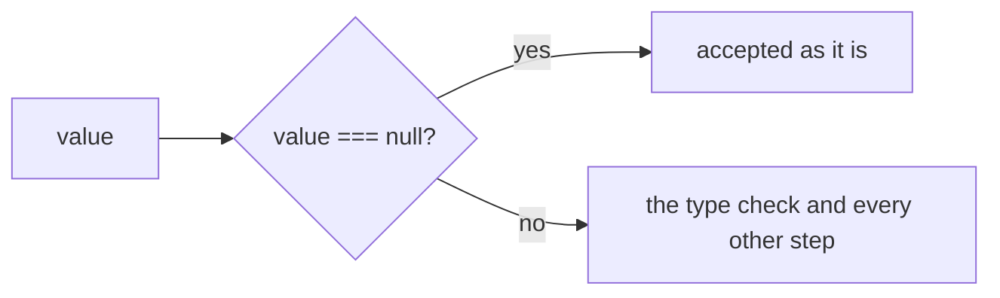
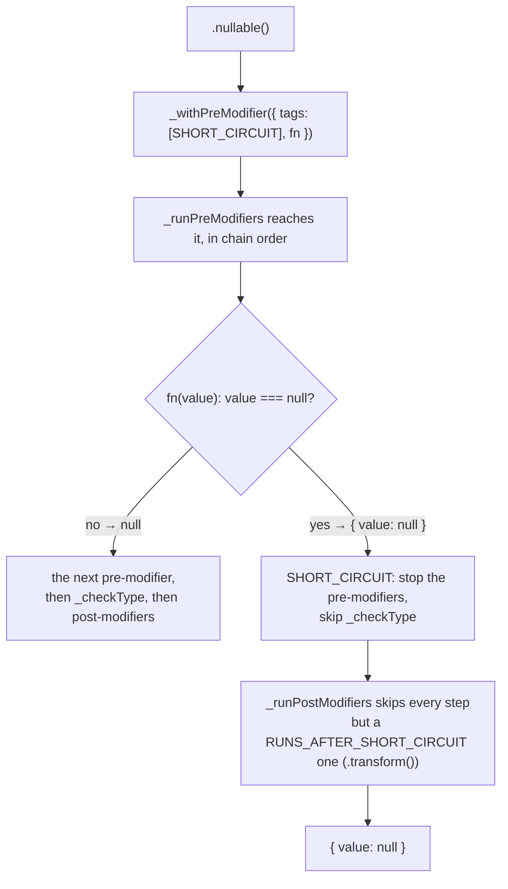
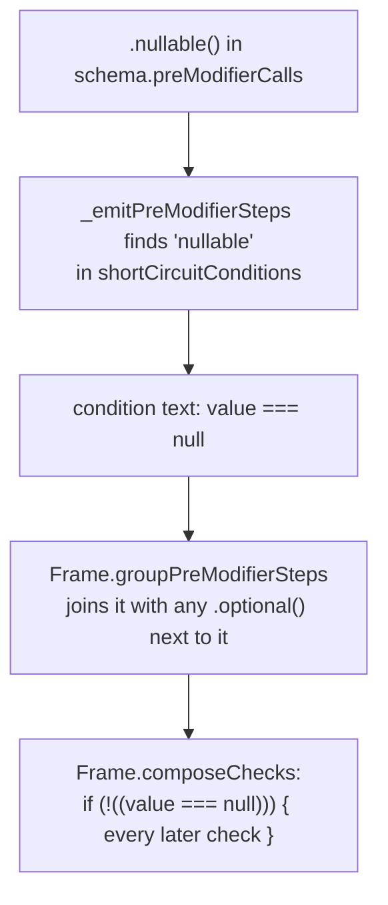

# Nullable

`.nullable()` makes a [Schema](./Concepts.md#schema) accept `null` as well. It is a [Shared Modifier](./Concepts.md#shared-modifier-and-local-modifier), so every Schema has it.

```ts
const deletedAt = pvl.string().nullable();

deletedAt.validate('2026-01-01'); // { value: '2026-01-01' }
deletedAt.validate(null); // { value: null }
deletedAt.validate(undefined); // { issues: [{ code: 'INVALID_TYPE', message: 'Expected string' }] }
```

Unlike [`.optional()`](./Optional.md), an object key stays required: `null` must be passed explicitly. Chain both to accept either.

## The short version

`null` is accepted on the spot and skips every check after it. Any other value goes on to be checked as usual.



## Interpreted

`.nullable()` works exactly as `.optional()` does, testing for `null`: it appends a [pre-modifier](./Concepts.md#pre-modifier-and-post-modifier) tagged `SHORT_CIRCUIT`, whose `{ value: null }` skips the rest of the pre-modifiers, the [type check](./Concepts.md#type-check) and every post-modifier except a `.transform()`.



## Compiled

`ChainableSchemaEmitter.shortCircuitConditions.nullable` writes the condition `value === null`, and the [Frame](./Concepts.md#frame) wraps every later check in `if (!(…))`.



`pvl.compile(pvl.string().nullable())` compiles to:

<!-- prettier-ignore -->
```ts
_validate(value: unknown, path: ReadonlyArray<PropertyKey>): PvlResult<unknown> {
  const issues: PvlIssue[] = [];
  if (!((value === null))) {
    if (typeof value !== "string") {
      issues.push({ code: "INVALID_TYPE", message: "Expected string", path: path.length > 0 ? path : undefined });
    }
  }
  return issues.length > 0 ? { issues } : { value };
}
```

`pvl.string().nullable().optional()` shares one guard: `if (!((value === null) || (value === undefined)))`.

## Order matters against `.coerce()`

`pvl.string().nullable().coerce()` keeps `null`, while `pvl.string().coerce().nullable()` turns it into `'null'` first. See [Coerce](./Coerce.md#order-matters-against-optional-and-nullable).

## Source

- [`chainableInterpretedSchema.ts`](../../packages/schema/src/schemas/chainableInterpretedSchema.ts): `nullable()`
- [`emitters/chainableSchemaEmitter.ts`](../../packages/schema-compiler/src/emitters/chainableSchemaEmitter.ts): `nullable`, in `shortCircuitConditions`
- [`emitters/frame.ts`](../../packages/schema-compiler/src/emitters/frame.ts): `groupPreModifierSteps`, `composeChecks`

Further reading: [pipeline.md](../specification/schema/pipeline.md), [ADR-0010](../adr/0010-modifiers-run-in-chain-order-around-the-type-check.md).
