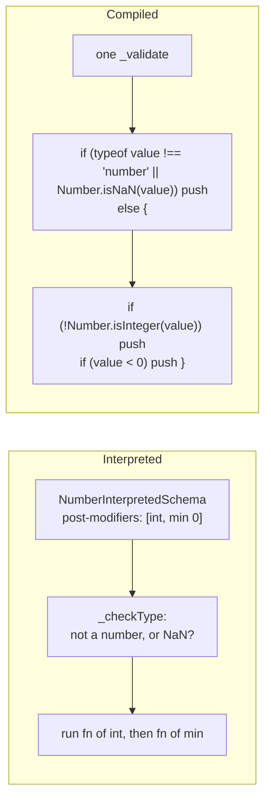
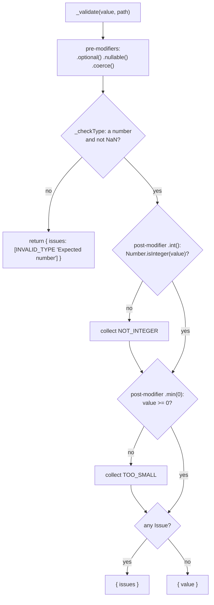
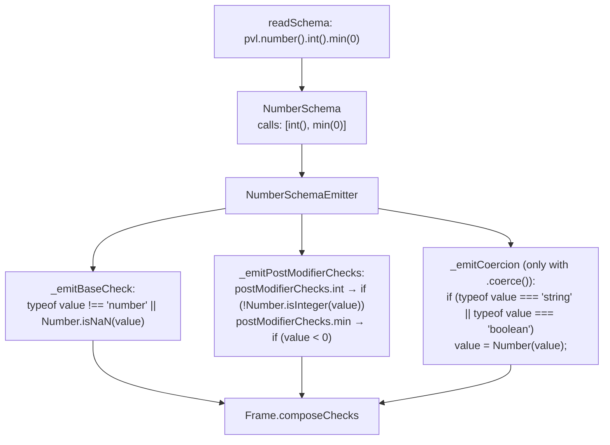
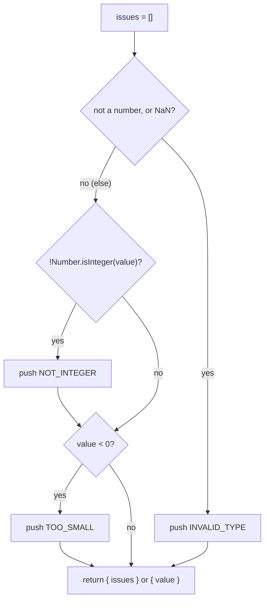

# Number schema

`pvl.number()` accepts any JavaScript `number` except `NaN`: integers, floats, `Infinity` and `-Infinity`. Its [Constraints](./Concepts.md#constraint) check the value's size and whether it is whole.

```ts
const age = pvl.number().int().min(0);

age.validate(36); // { value: 36 }
age.validate(-1.5); // { issues: [NOT_INTEGER 'Number must be an integer', TOO_SMALL 'Number must be greater than or equal to 0'] }
age.validate(NaN); // { issues: [{ code: 'INVALID_TYPE', message: 'Expected number' }] }
```

`NaN` is rejected by the type check itself: accepted, it would silently pass every `.min()` and `.max()` comparison. A `bigint` is never a number, coerced or not; that is [`pvl.bigint()`](./BigInt-Schema.md)'s job.

## At a glance



## Interpreted

`NumberInterpretedSchema` runs the [interpreted pipeline](./Interpreted-Pipeline.md). Its own parts:

- **`_checkType`**: `typeof value !== 'number' || Number.isNaN(value)` reports `INVALID_TYPE`, `"Expected number"`.
- **`.min()`, `.max()`, `.int()`**: each appends a [post-modifier](./Concepts.md#pre-modifier-and-post-modifier), run in chain order once the type check passed, every failing one reported.
- **`_coerceInput`**: `coerceToNumber`, for [`.coerce()`](./Coerce.md): a `string` or `boolean` becomes `Number(value)`.



## Compiled

### What the compiler does

`pvl.number()` takes no argument, so `readSchema` reads it into a `NumberSchema` holding only its chained calls, and `NumberSchemaEmitter` writes its parts.



### What the emitted code does

`pvl.compile(pvl.number().int().min(0))` compiles to:

<!-- prettier-ignore -->
```ts
_validate(value: unknown, path: ReadonlyArray<PropertyKey>): PvlResult<unknown> {
  const issues: PvlIssue[] = [];
  if (typeof value !== "number" || Number.isNaN(value)) {
    issues.push({ code: "INVALID_TYPE", message: "Expected number", path: path.length > 0 ? path : undefined });
  } else {
    if (!Number.isInteger(value)) {
      issues.push({ code: "NOT_INTEGER", message: "Number must be an integer", path: path.length > 0 ? path : undefined });
    }
    if (value < 0) {
      issues.push({ code: "TOO_SMALL", message: "Number must be greater than or equal to 0", path: path.length > 0 ? path : undefined });
    }
  }
  return issues.length > 0 ? { issues } : { value };
}
```



## Local Modifiers

| Method                  | Issue code    | Default message                             | Interpreted passes when   | Compiled fails when        |
| ----------------------- | ------------- | ------------------------------------------- | ------------------------- | -------------------------- |
| `.min(n, { message }?)` | `TOO_SMALL`   | `Number must be greater than or equal to n` | `value >= n`              | `value < n`                |
| `.max(n, { message }?)` | `TOO_BIG`     | `Number must be less than or equal to n`    | `value <= n`              | `value > n`                |
| `.int({ message }?)`    | `NOT_INTEGER` | `Number must be an integer`                 | `Number.isInteger(value)` | `!Number.isInteger(value)` |

## Source

- [`numberInterpretedSchema.ts`](../../packages/schema/src/schemas/numberInterpretedSchema.ts): `NumberInterpretedSchema`, `NUMBER_SCHEMA_ISSUE_MESSAGE`
- [`schemas/numberSchema.ts`](../../packages/schema-compiler/src/schemas/numberSchema.ts): `NumberSchema`
- [`emitters/numberSchemaEmitter.ts`](../../packages/schema-compiler/src/emitters/numberSchemaEmitter.ts): `NumberSchemaEmitter`

Further reading: [schema-types.md](../specification/schema/schema-types.md).
