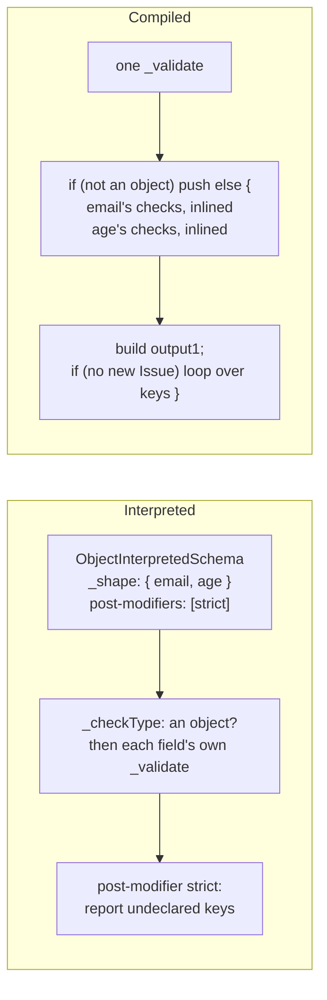
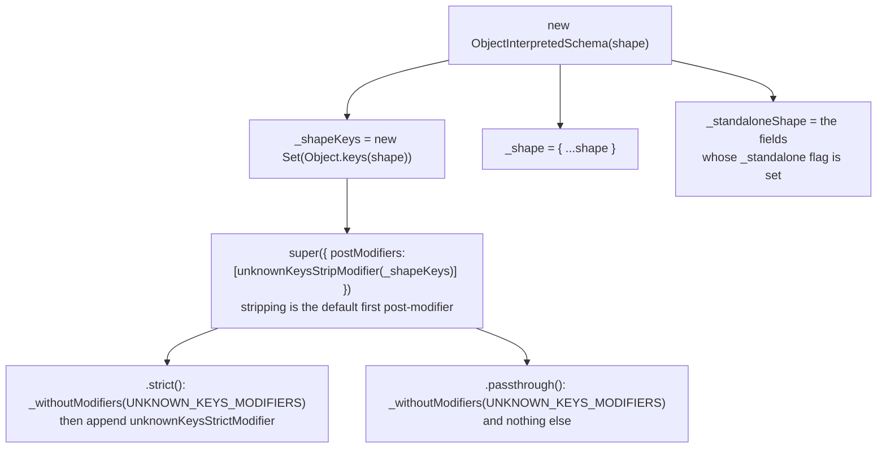
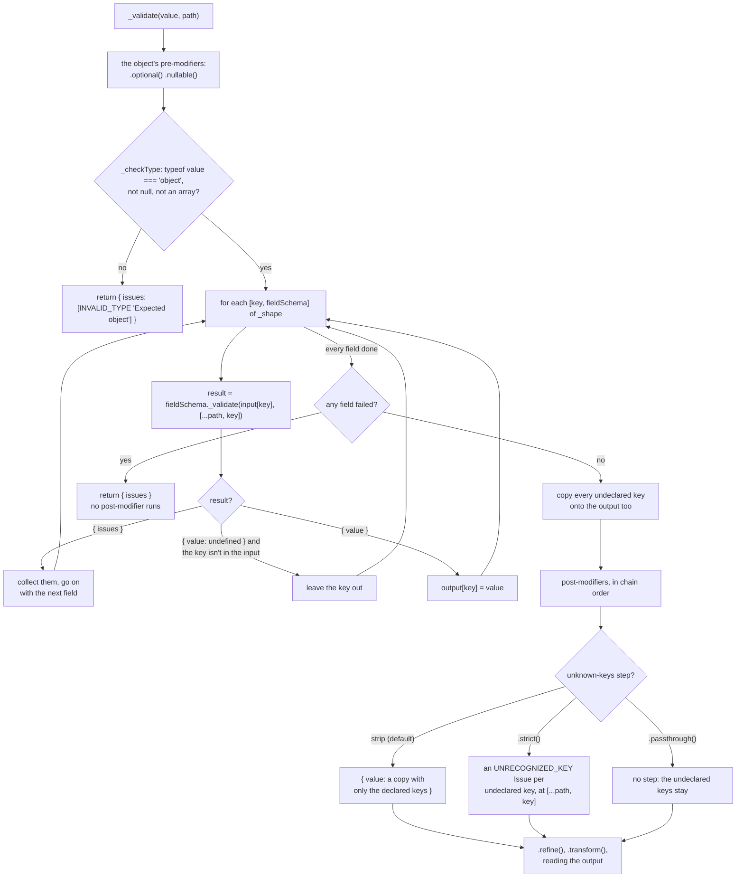
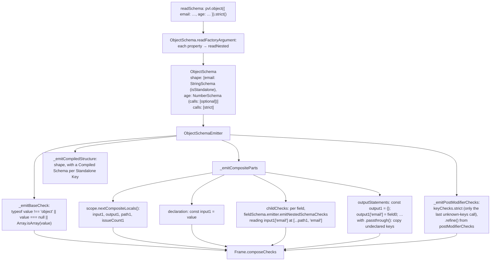
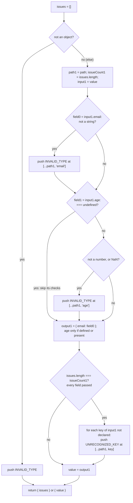
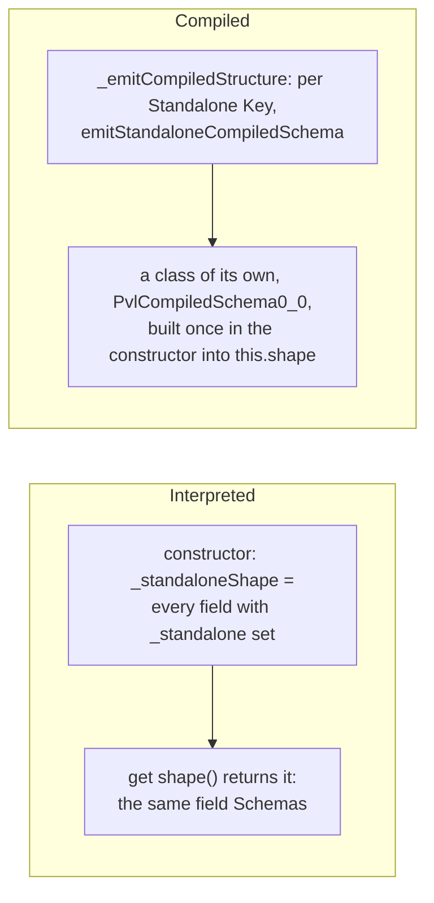

# Object schema

`pvl.object(shape)` accepts a plain object whose fields match the [Schemas](./Concepts.md#schema) in `shape`. It is a composite: it holds other Schemas, at any depth.

```ts
const user = pvl.object({
  email: pvl.string().standalone(),
  age: pvl.number().optional(),
});

user.validate({ email: 'ada@example.com', role: 'x' }); // { value: { email: 'ada@example.com' } }: role stripped
user.strict().validate({ email: 'a@b.c', role: 'x' }); // { issues: [UNRECOGNIZED_KEY at ['role']] }
user.validate({ email: 42, age: 'old' }); // { issues: [INVALID_TYPE at ['email'], INVALID_TYPE at ['age']] }
```

- Every field is checked, even after an earlier one failed, so every problem is reported at once.
- A key the shape doesn't declare is **stripped** from the output by default. `.strict()` reports it instead, and `.passthrough()` keeps it.
- An `.optional()` field's key may be left out, and stays left out of the output rather than becoming `key: undefined`.
- An array or `null` isn't an object here.

## At a glance



## Interpreted

### Building it

The constructor does the per-shape work once, not on every validation:



Stripping, `.strict()` and `.passthrough()` each remove the other's step, found by the factory that built it, so the last one chained wins.

### Running it

`_checkType` checks that the value is an object, then calls every field's own `_validate` with the field's key added to the path. Each field runs its whole [pipeline](./Interpreted-Pipeline.md) there: its pre-modifiers, its type check, its post-modifiers.



## Compiled

### What the compiler does

`pvl.object(shape)`'s shape is the factory's argument, so it must be an object literal written in place, or a top-level `const` of the same file holding one. `ObjectSchema.readFactoryArgument` reads each field through `readNested`, recursively, into the Schema of its own factory.



There is no stripping step: the compiled output object is built from the declared fields only, so undeclared keys are never on it unless `.passthrough()` copies them.

### What the emitted code does

`pvl.compile(pvl.object({ email: pvl.string().standalone(), age: pvl.number().optional() }).strict())` compiles to this `_validate`:

<!-- prettier-ignore -->
```ts
_validate(value: unknown, path: ReadonlyArray<PropertyKey>): PvlResult<unknown> {
  const issues: PvlIssue[] = [];
  if (typeof value !== "object" || value === null || Array.isArray(value)) {
    issues.push({ code: "INVALID_TYPE", message: "Expected object", path: path.length > 0 ? path : undefined });
  } else {
    const path1 = path;
    const issueCount1 = issues.length;
    const input1 = value as Record<string, unknown>;

    // email
    const field0 = input1["email"];
    if (typeof field0 !== "string") {
      issues.push({ code: "INVALID_TYPE", message: "Expected string", path: [...path1, "email"] });
    }

    // age
    const field1 = input1["age"];
    if (!((field1 === undefined))) {
      if (typeof field1 !== "number" || Number.isNaN(field1)) {
        issues.push({ code: "INVALID_TYPE", message: "Expected number", path: [...path1, "age"] });
      }
    }

    const output1: Record<string, unknown> = {};
    output1["email"] = field0;
    if (field1 !== undefined || Object.hasOwn(input1, "age")) {
      output1["age"] = field1;
    }
    if (issues.length === issueCount1) {
      for (const key of Object.keys(input1)) {
        if (key !== "email" && key !== "age") {
          issues.push({ code: "UNRECOGNIZED_KEY", message: `Unrecognized key "${key}"`, path: [...path1, key] });
        }
      }
    }
    value = output1;
  }
  return issues.length > 0 ? { issues } : { value };
}
```



A nested object or array field is inlined the same way, one level deeper, with its own numbered locals (`path2`, `input2`, `output2`); its value is declared with `let`, as its checks replace it with the output they built. [Compiled schema runtime](./Compiled-Schema-Runtime.md#nested-schemas) shows one.

## Undeclared keys

|                  | Interpreted                                                     | Compiled                                                                 |
| ---------------- | --------------------------------------------------------------- | ------------------------------------------------------------------------ |
| default (strip)  | `_checkType` keeps them, a strip post-modifier copies them away | the output is built from the declared fields only                        |
| `.strict()`      | a post-modifier reports each one, once every field passed       | a loop over `Object.keys(input1)` behind `issues.length === issueCount1` |
| `.passthrough()` | no step: `_checkType`'s output keeps them                       | an output statement copies each one onto `output1`                       |

A `.refine()` on a `.strict()` object sees the undeclared keys too, interpreted and compiled, so the compiled object copies them onto its output in that case as well.

## Standalone Keys

A field marked `.standalone()` is a [Standalone Key](./Concepts.md#standalone-key): it is in the object's `shape`, so it can be validated on its own (`user.shape.email.validate(…)`). Only Standalone Keys are in `shape`. Marking a field changes no check.



The compiled `user` above has, besides its `_validate`:

<!-- prettier-ignore -->
```ts
readonly shape: { readonly email: PvlSchema<string, string> & PvlStandaloneMarker };

constructor() {
  this.shape = {
    "email": (new (class PvlCompiledSchema0_0 implements PvlSchema<string, string> {
      declare readonly [PVL_SCHEMA_BRAND]: true;
      declare readonly [PVL_STANDALONE_BRAND]: true;
      readonly _standalone: boolean = true;
      …
    })() as PvlSchema<string, string> & PvlStandaloneMarker),
  };
}
```

The parent's own `_validate` still inlines the field's checks: it never calls `shape.email`. An object with no Standalone Key gets `readonly shape: {} = {};`, and a transformed object has no `shape` at all.

## Local Modifiers

| Method                  | Issue code         | Default message            | What it does                                     |
| ----------------------- | ------------------ | -------------------------- | ------------------------------------------------ |
| `.strict({ message }?)` | `UNRECOGNIZED_KEY` | `Unrecognized key "<key>"` | Reports each undeclared key, at `[...path, key]` |
| `.passthrough()`        | none               | none                       | Keeps undeclared keys on the output              |

## Source

- [`objectInterpretedSchema.ts`](../../packages/schema/src/schemas/objectInterpretedSchema.ts): `ObjectInterpretedSchema`, the unknown-key modifiers, `OBJECT_SCHEMA_ISSUE_MESSAGE`
- [`schemas/objectSchema.ts`](../../packages/compiler/src/schemas/objectSchema.ts): `ObjectSchema`
- [`emitters/objectSchemaEmitter.ts`](../../packages/compiler/src/emitters/objectSchemaEmitter.ts): `ObjectSchemaEmitter`
- [`emitters/frame.ts`](../../packages/compiler/src/emitters/frame.ts): `composeCompositeStatements`

Further reading: [schema-types.md](../specification/schema/schema-types.md), [standalone-keys.md](../specification/standalone-keys.md), [ADR-0007](../adr/0007-object-strips-unknown-keys-by-default.md), [ADR-0012](../adr/0012-composite-schemas-collect-every-issue.md), [ADR-0036](../adr/0036-standalone-keys-are-reinstated-and-shape-and-element-survive-every-call-but-transform.md).
