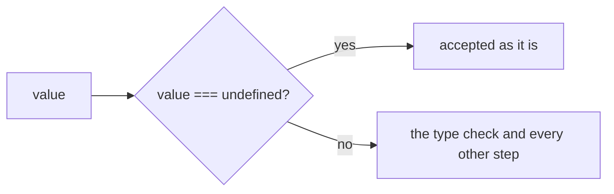
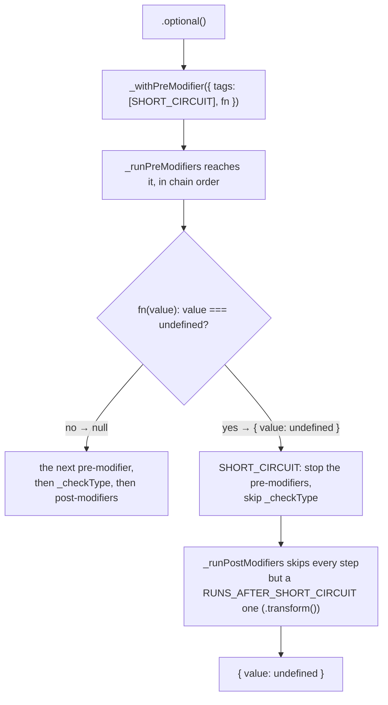
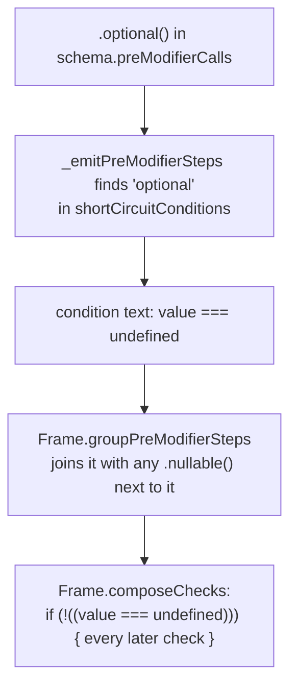

# Optional

`.optional()` makes a [Schema](./Concepts.md#schema) accept `undefined` as well. It is a [Shared Modifier](./Concepts.md#shared-modifier-and-local-modifier), so every Schema has it.

```ts
const nickname = pvl.string().optional();

nickname.validate('Ada'); // { value: 'Ada' }
nickname.validate(undefined); // { value: undefined }
nickname.validate(42); // { issues: [{ code: 'INVALID_TYPE', message: 'Expected string' }] }
```

On an object field, it also makes the key optional: an omitted key stays omitted from the output instead of becoming `key: undefined`.

## The short version

`undefined` is accepted on the spot and skips every check after it. Any other value goes on to be checked as usual.



## Interpreted

`.optional()` appends a [pre-modifier](./Concepts.md#pre-modifier-and-post-modifier) tagged `SHORT_CIRCUIT`. Its function returns `{ value: undefined }` for `undefined` and `null` ("go on") for anything else. Because of the tag, that `{ value }` ends the pipeline early: the remaining pre-modifiers, the [type check](./Concepts.md#type-check) and every post-modifier are skipped, except a `.transform()`.



## Compiled

`ChainableSchemaEmitter.shortCircuitConditions.optional` writes the condition `value === undefined`. The [Frame](./Concepts.md#frame) wraps every check after it in `if (!(…))`, so an accepted value skips them and is left as it is.



`pvl.compile(pvl.string().optional())` compiles to:

<!-- prettier-ignore -->
```ts
_validate(value: unknown, path: ReadonlyArray<PropertyKey>): PvlResult<unknown> {
  const issues: PvlIssue[] = [];
  if (!((value === undefined))) {
    if (typeof value !== "string") {
      issues.push({ code: "INVALID_TYPE", message: "Expected string", path: path.length > 0 ? path : undefined });
    }
  }
  return issues.length > 0 ? { issues } : { value };
}
```

`.optional()` and `.nullable()` chained one after the other share one guard: `if (!((value === undefined) || (value === null)))`.

## Order matters against `.coerce()`

Both are pre-modifiers, so they run in the order they were chained:

- `pvl.string().optional().coerce()` accepts `undefined` before the conversion runs, so it stays `undefined`.
- `pvl.string().coerce().optional()` converts first: `undefined` becomes `'undefined'`, which `.optional()` no longer sees as `undefined`.

See [Coerce](./Coerce.md#order-matters-against-optional-and-nullable) for the compiled code of both.

## As an object field

Interpreted and compiled, an object leaves an omitted optional key out of its output: the interpreted `_checkType` skips a field whose result is `undefined` when the key isn't in the input, and the compiled object writes the key only `if (field1 !== undefined || Object.hasOwn(input1, "age"))`. See [Object schema](./Object-Schema.md).

## Source

- [`chainableInterpretedSchema.ts`](../../packages/schema/src/schemas/chainableInterpretedSchema.ts): `optional()`
- [`emitters/chainableSchemaEmitter.ts`](../../packages/compiler/src/emitters/chainableSchemaEmitter.ts): `optional`, in `shortCircuitConditions`
- [`emitters/frame.ts`](../../packages/compiler/src/emitters/frame.ts): `groupPreModifierSteps`, `composeChecks`

Further reading: [pipeline.md](../specification/schema/pipeline.md), [ADR-0010](../adr/0010-modifiers-run-in-chain-order-around-the-type-check.md).
