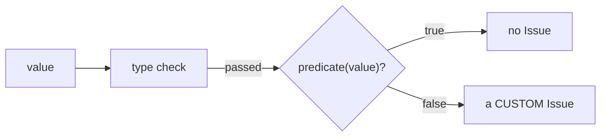
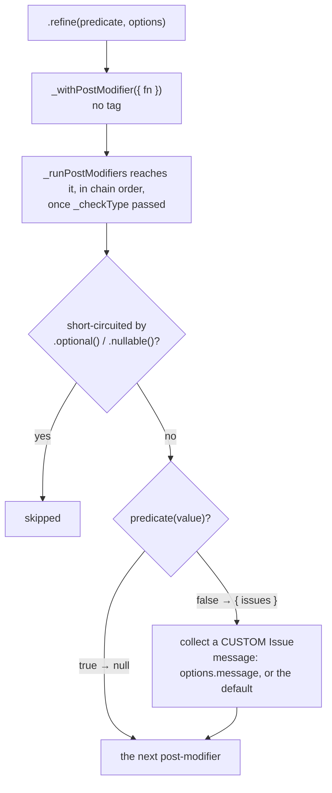
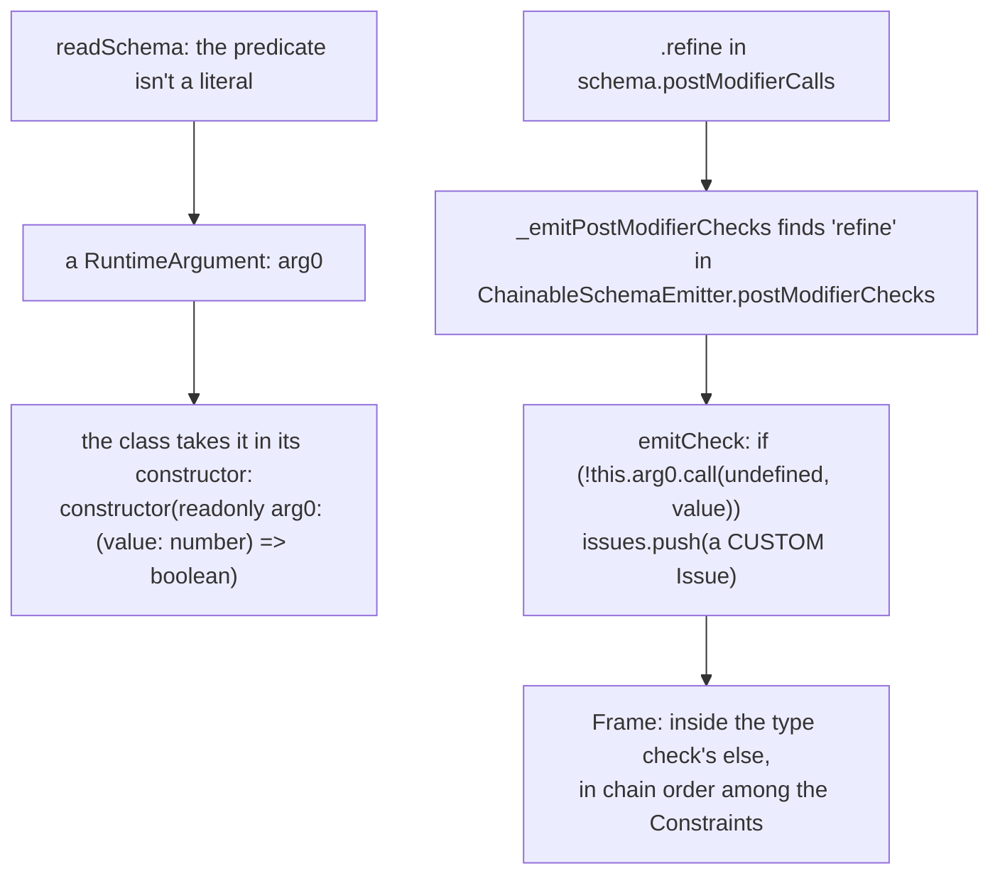

# Refine

`.refine(predicate, options?)` adds your own yes/no check, a [Refinement](./Concepts.md#refinement-coercion-transform). It is a [Shared Modifier](./Concepts.md#shared-modifier-and-local-modifier), so every Schema has it. This is where a check the library has no built-in for belongs: a regex, a rule across two fields.

```ts
const even = pvl.number().refine((value) => value % 2 === 0, { message: 'must be even' });

even.validate(4); // { value: 4 }
even.validate(3); // { issues: [{ code: 'CUSTOM', message: 'must be even' }] }
```

The predicate never changes the value. Returning `false` reports a `CUSTOM` Issue, with your message or the default `"Invalid type"`.

## The short version



It runs after the type check, in chain order among the [Constraints](./Concepts.md#constraint): a failing `.min()` before it doesn't stop it, and both Issues are reported. A value `.optional()` or `.nullable()` accepted never reaches it.

## Interpreted

`.refine()` appends an untagged [post-modifier](./Concepts.md#pre-modifier-and-post-modifier). Its function calls your predicate and returns `null` when it holds, or `{ issues: [new Issue(CUSTOM, path, message)] }`.



On an object or array, the predicate sees the Schema's **output**: the value its fields or elements built, not the raw input.

## Compiled

The compiler never copies your function's body. The function is a [Runtime Argument](./Concepts.md#runtime-argument): the Compiled Schema takes it through its constructor, evaluated once where `pvl.compile(...)` was, and the emitted check calls it. The options object, when written as a literal, is read at compile time, so the message is written in as text.



`pvl.compile(pvl.number().refine((value) => value % 2 === 0, { message: 'must be even' }))` compiles to (shortened):

<!-- prettier-ignore -->
```ts
export const even = (new (class PvlCompiledSchema0 implements PvlSchema<number, number> {
  …
  constructor(readonly arg0: (value: number) => boolean) {}
  …
  _validate(value: unknown, path: ReadonlyArray<PropertyKey>): PvlResult<unknown> {
    const issues: PvlIssue[] = [];
    if (typeof value !== "number" || Number.isNaN(value)) {
      issues.push({ code: "INVALID_TYPE", message: "Expected number", path: path.length > 0 ? path : undefined });
    } else {
      if (!this.arg0.call(undefined, value as never)) {
        issues.push({ code: "CUSTOM", message: "must be even", path: path.length > 0 ? path : undefined });
      }
    }
    return issues.length > 0 ? { issues } : { value };
  }
  …
})((value) => value % 2 === 0) as PvlSchema<number, number>);
```

The predicate is passed exactly as you wrote it, so a function you imported or defined elsewhere in the file is reached as it was in the source. Its parameter is typed as the methods chained before it left the value (`number`, or `number | null` after `.nullable()`).

## Source

- [`chainableInterpretedSchema.ts`](../../packages/schema/src/schemas/chainableInterpretedSchema.ts): `refine()`
- [`emitters/chainableSchemaEmitter.ts`](../../packages/schema-compiler/src/emitters/chainableSchemaEmitter.ts): `refine`, in `postModifierChecks`, and `_spellParameterTypes`
- [`schemas/runtimeArgument.ts`](../../packages/schema-compiler/src/schemas/runtimeArgument.ts): `RuntimeArgument`

Further reading: [pipeline.md](../specification/schema/pipeline.md#refinements-transforms-coercion), [ADR-0035](../adr/0035-modifiers-compile-to-calls-to-the-users-own-functions-typed-at-their-place-in-the-chain.md).
