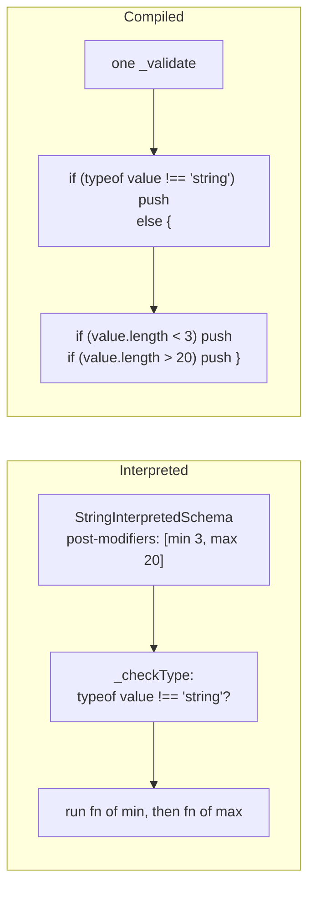
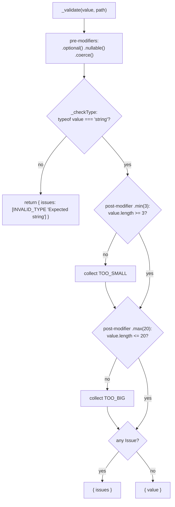
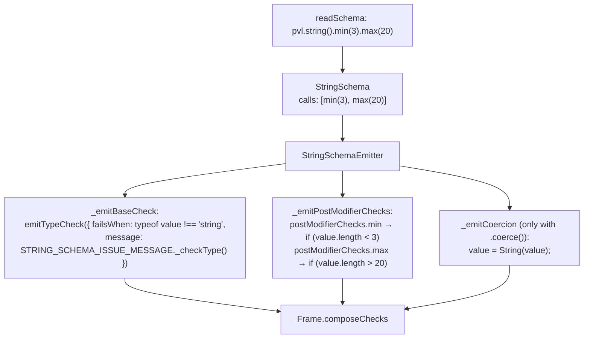
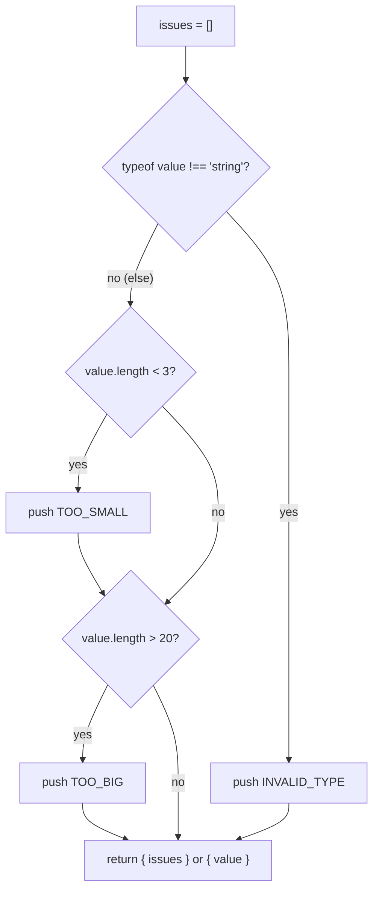

# String schema

`pvl.string()` accepts any `string`. Its [Constraints](./Concepts.md#constraint) check the length.

```ts
const username = pvl.string().min(3).max(20);

username.validate('ada_l'); // { value: 'ada_l' }
username.validate('al'); // { issues: [{ code: 'TOO_SMALL', message: 'String must contain at least 3 character(s)' }] }
username.validate(42); // { issues: [{ code: 'INVALID_TYPE', message: 'Expected string' }] }
```

## At a glance



## Interpreted

`StringInterpretedSchema` runs the [interpreted pipeline](./Interpreted-Pipeline.md). Its own parts:

- **`_checkType`**: `typeof value !== 'string'` reports `INVALID_TYPE`, `"Expected string"`; anything else passes as it is.
- **`.min()`, `.max()`, `.length()`**: each appends a [post-modifier](./Concepts.md#pre-modifier-and-post-modifier) comparing `value.length`, so they run in chain order once the type check passed, and every failing one is reported.
- **`_coerceInput`**: `coerceToString`, for [`.coerce()`](./Coerce.md).



## Compiled

### What the compiler does

`pvl.string()` takes no argument, so `readSchema` reads it into a `StringSchema` holding only its chained calls. `StringSchemaEmitter` writes its parts; [Compiled schema runtime](./Compiled-Schema-Runtime.md) shows how they are put together.



Each Constraint's message is computed while compiling with the same `STRING_SCHEMA_ISSUE_MESSAGE` function the interpreted Schema calls, and written in as text. With a [Runtime Argument](./Concepts.md#runtime-argument) (`.max(maxLength)`), the message is built once in the constructor instead, from `argumentMessages`.

### What the emitted code does

`pvl.compile(pvl.string().min(3).max(20))` compiles to this `_validate` (the whole class is on [Compiled schema runtime](./Compiled-Schema-Runtime.md#the-class)):

<!-- prettier-ignore -->
```ts
_validate(value: unknown, path: ReadonlyArray<PropertyKey>): PvlResult<unknown> {
  const issues: PvlIssue[] = [];
  if (typeof value !== "string") {
    issues.push({ code: "INVALID_TYPE", message: "Expected string", path: path.length > 0 ? path : undefined });
  } else {
    if (value.length < 3) {
      issues.push({ code: "TOO_SMALL", message: "String must contain at least 3 character(s)", path: path.length > 0 ? path : undefined });
    }
    if (value.length > 20) {
      issues.push({ code: "TOO_BIG", message: "String must contain at most 20 character(s)", path: path.length > 0 ? path : undefined });
    }
  }
  return issues.length > 0 ? { issues } : { value };
}
```



## Local Modifiers

| Method                     | Issue code       | Default message                               | Interpreted passes when | Compiled fails when  |
| -------------------------- | ---------------- | --------------------------------------------- | ----------------------- | -------------------- |
| `.min(n, { message }?)`    | `TOO_SMALL`      | `String must contain at least n character(s)` | `value.length >= n`     | `value.length < n`   |
| `.max(n, { message }?)`    | `TOO_BIG`        | `String must contain at most n character(s)`  | `value.length <= n`     | `value.length > n`   |
| `.length(n, { message }?)` | `INVALID_LENGTH` | `String must contain exactly n character(s)`  | `value.length === n`    | `value.length !== n` |

There are no regex-based checks (`.email()`, `.regex()`), to keep every built-in check fast: attach your own with [`.refine()`](./Refine.md).

## Source

- [`stringInterpretedSchema.ts`](../../packages/schema/src/schemas/stringInterpretedSchema.ts): `StringInterpretedSchema`, `STRING_SCHEMA_ISSUE_MESSAGE`
- [`schemas/stringSchema.ts`](../../packages/schema-compiler/src/schemas/stringSchema.ts): `StringSchema`
- [`emitters/stringSchemaEmitter.ts`](../../packages/schema-compiler/src/emitters/stringSchemaEmitter.ts): `StringSchemaEmitter`

Further reading: [schema-types.md](../specification/schema/schema-types.md), [ADR-0008](../adr/0008-no-regex-backed-constraints-in-v1.md).
