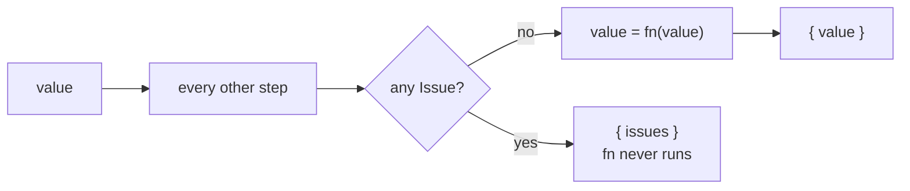
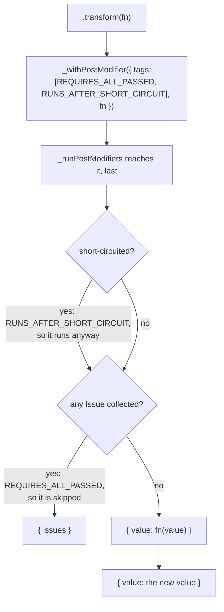
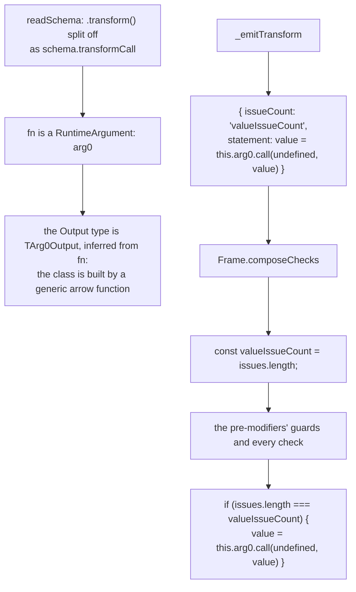

# Transform

`.transform(fn)` converts an accepted value into a different one, a [Transform](./Concepts.md#refinement-coercion-transform), and changes the Schema's Output type to whatever `fn` returns. It is a [Shared Modifier](./Concepts.md#shared-modifier-and-local-modifier), so every Schema has it.

```ts
const trimmedLength = pvl.string().transform((value) => value.trim().length);

trimmedLength.validate('  hello  '); // { value: 5 }
trimmedLength.validate(42); // { issues: [...] }: never reaches the transform
```

It **ends the chain**: the result is a plain Schema, which validates but takes no further Modifier, so chain every other Modifier before it. A transformed object has no `shape`, and a transformed array no `element`, as they describe a value the function replaces.

## The short version



It is the last thing to run, and only when nothing failed, so `fn` only ever sees a value the Schema accepted. Unlike every other post-modifier, it still runs after `.optional()` or `.nullable()` accepted the value, so `fn` is typed to receive `undefined` or `null` too.

## Interpreted

`.transform()` appends a [post-modifier](./Concepts.md#pre-modifier-and-post-modifier) tagged `REQUIRES_ALL_PASSED` and `RUNS_AFTER_SHORT_CIRCUIT`. As nothing can be chained after it, it is always the last one.



## Compiled

Like a [Refine](./Refine.md) predicate, `fn` is a [Runtime Argument](./Concepts.md#runtime-argument): the Compiled Schema calls your function, it never copies its body. `readSchema` splits the `.transform()` call off the chain as `transformCall`, and `ChainableSchemaEmitter._emitTransform` writes the assignment. The [Frame](./Concepts.md#frame) counts the Issues **before** the pre-modifiers, so a short-circuit doesn't skip the transform, and runs it only if that count didn't change.



`pvl.compile(pvl.string().transform((value) => value.trim().length))` compiles to (shortened):

<!-- prettier-ignore -->
```ts
export const trimmedLength = (<TArg0Output,>(arg0: (value: string) => TArg0Output): PvlSchema<string, TArg0Output> => new (class PvlCompiledSchema0 implements PvlSchema<string, TArg0Output> {
  …
  constructor(readonly arg0: (value: string) => TArg0Output) {}
  …
  _validate(value: unknown, path: ReadonlyArray<PropertyKey>): PvlResult<unknown> {
    const issues: PvlIssue[] = [];
    const valueIssueCount = issues.length;
    if (typeof value !== "string") {
      issues.push({ code: "INVALID_TYPE", message: "Expected string", path: path.length > 0 ? path : undefined });
    }
    if (issues.length === valueIssueCount) {
      value = this.arg0.call(undefined, value as never);
    }
    return issues.length > 0 ? { issues } : { value };
  }
  …
})(arg0))((value) => value.trim().length);
```

The generic arrow function around the class is there for the types only: TypeScript infers `TArg0Output` (`number` here) from the function it is passed, exactly as it infers the interpreted `.transform()`'s output.

Nested, a transformed field or element's value is declared with `let`, as the transform reassigns it, and its Issue count is named after it (`field0IssueCount`).

## Source

- [`chainableInterpretedSchema.ts`](../../packages/schema/src/schemas/chainableInterpretedSchema.ts): `transform()`
- [`schemas/readSchema.ts`](../../packages/schema-compiler/src/schemas/readSchema.ts): splits off `transformCall`
- [`emitters/chainableSchemaEmitter.ts`](../../packages/schema-compiler/src/emitters/chainableSchemaEmitter.ts): `_emitTransform`, `_spellTypes`
- [`emitters/frame.ts`](../../packages/schema-compiler/src/emitters/frame.ts): `composeChecks`, `composeSchema`

Further reading: [pipeline.md](../specification/schema/pipeline.md#transformation), [ADR-0016](../adr/0016-transform-and-compile-end-the-modifier-chain.md), [ADR-0035](../adr/0035-modifiers-compile-to-calls-to-the-users-own-functions-typed-at-their-place-in-the-chain.md).
