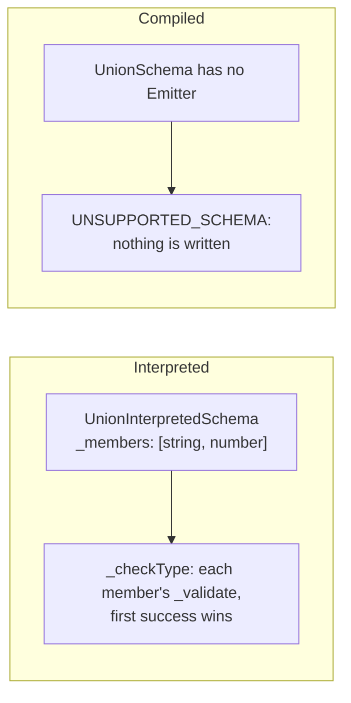
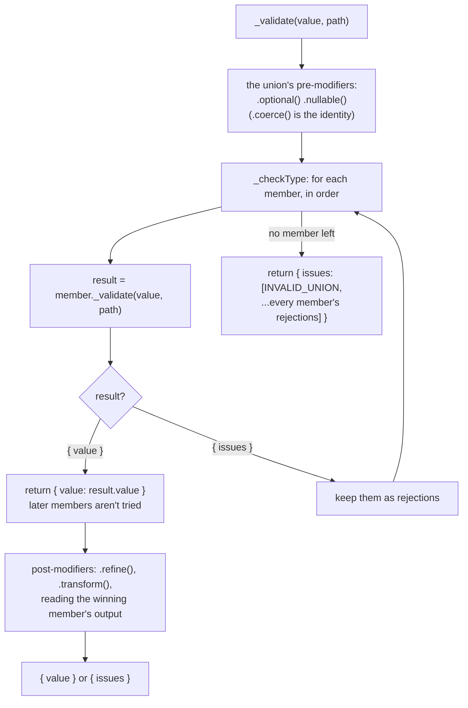
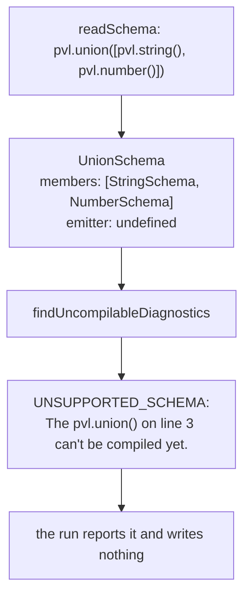

# Union schema

`pvl.union([a, b, …])` accepts a value that any one of its member [Schemas](./Concepts.md#schema) accepts. It tries the members in order and takes the first that accepts.

```ts
const id = pvl.union([pvl.string(), pvl.number()]);

id.validate('u-1'); // { value: 'u-1' }
id.validate(7); // { value: 7 }
id.validate(true); // { issues: [INVALID_UNION 'Value matches no union member', INVALID_TYPE 'Expected string', INVALID_TYPE 'Expected number'] }
```

When no member accepts, it reports one `INVALID_UNION` Issue followed by every member's own Issues, in member order. There is no shortcut on a shared key (a "discriminated union") yet.

**A union isn't compiled yet.** Its interpreted version works fully; the compiler rejects it. See [Compiled](#compiled) below.

## At a glance



## Interpreted

`UnionInterpretedSchema` holds its members and runs the [interpreted pipeline](./Interpreted-Pipeline.md). Its `_checkType` calls each member's own `_validate` at the **same** path (a member isn't a field, so nothing is added to it), and each member runs its whole pipeline there.



As the first accepting member wins, the member's own output is the union's: `pvl.union([pvl.string().transform((s) => s.length), pvl.string()])` turns every string into its length.

## Compiled

The compiler reads a union, but has no Emitter for it. `readSchema` maps `pvl.union` to `UnionSchema`, which reads its members like any other composite, and whose `emitter` is left `undefined`. `findUncompilableDiagnostics` reports that as `UNSUPPORTED_SCHEMA`, and since any error stops the run, **nothing is written** for any file.



This happens for a union anywhere in a marked Schema: wrapped directly, or as a field or element at any depth. Running `pvl compile` on

```ts
import { pvl } from '@pvl/schema';

export const id = pvl.compile(pvl.union([pvl.string(), pvl.number()]));
```

prints

```
error UNSUPPORTED_SCHEMA: The `pvl.union()` on line 3 can't be compiled yet. (…/src/schemas/union.ts)
```

and exits with `1`.

**Until it compiles**, leave the Schema holding a union out of `pvl.compile(...)`: it validates interpreted, exactly as before. A Schema next to it can still be compiled on its own, and a compiled Schema can be a member of an interpreted union, as it is a Schema like any other.

## Local Modifiers

None.

## Source

- [`unionInterpretedSchema.ts`](../../packages/schema/src/schemas/unionInterpretedSchema.ts): `UnionInterpretedSchema`, `UNION_SCHEMA_ISSUE_MESSAGE`
- [`schemas/unionSchema.ts`](../../packages/schema-compiler/src/schemas/unionSchema.ts): `UnionSchema`
- [`schemas/schema.ts`](../../packages/schema-compiler/src/schemas/schema.ts): `findUncompilableDiagnostics`

Further reading: [schema-types.md](../specification/schema/schema-types.md), [compilation.md](../specification/schema-compiler/compilation.md#what-reads-statically).
